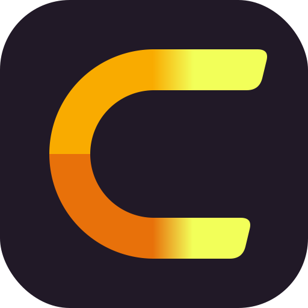

<p align="center">
  
</p>

<h1 align="center">Comfy Colab Kit</h1>

<p align="center">
  <b>随时可打开、按需唤醒的 Colab ComfyUI —— 打开网址；睡着就点“唤醒”看它启动；醒来后就是你的 ComfyUI 应用。</b>
</p>

<p align="center">
  <a href="README.md">English</a> •
  简体中文
</p>

<p align="center">
  <a href="LICENSE"></a>
  
  
</p>

---

> [!IMPORTANT]
> **仅供个人使用。** Colab 算力属于你的 Google 账号，开放给他人使用可能违反 Colab 条款与 FAQ（如禁止转售或共享算力），
> 有封号风险。建议只给自己或极少数家人朋友使用。本项目与 Google、Comfy Org 无隶属关系。

---

## 📖 概述

VPS 上运行一个轻量网关 **comfy-gate**（Python / aiohttp），前端受 Cloudflare Access 保护。

> [!NOTE]
> **网关的核心定位**：`comfy-gate` 本质上是一个**生命周期冷启动与自动休眠网关** —— 它**绝非**自己重新造一套 ComfyUI 前端。当 GPU 休眠时，它展示零算力开销的唤醒卡片与实时 SSE 启动进度；一旦启动就绪（`ready`），网关的反向代理将无缝直通**官方原汁原味的 ComfyUI Web 应用**（包括完整节点图、App 线性模式、自定义节点、扩展插件生态与 WebSocket 实时流），仅在右下角注入轻量浮层用于在 App 视图与节点图之间快速切换。

| 支柱 | 用户看到什么 | 实现 |
|---|---|---|
| **1 按需唤醒** | 休眠卡片 → 唤醒 → 阶段与日志 → 官方 ComfyUI 界面 | 10 状态状态机，`colab new`（L4）+ `colab exec` 初始化，同主机双向反代（HTTP + `/ws`） |
| **2 可切换 Profile** | 唤醒前选择 MOSS-Image、SD3.5、Qwen 等 | `profile.yaml` + JSON Schema；零密钥，模型按公开 URL 引用 |
| **3 自动停机** | 浮层显示剩余时间；闲置 / 会话上限 / 静默时段 / CU 预算触发休眠 | 全部规则严格由 `.env` 配置控制 |

## 💡 为什么需要 Comfy Colab Kit？（工作流革命）

传统的 Colab 使用方式必须坐在电脑前，在浏览器标签页逐个手动执行单元格代码，还要时刻提防因笔记本电脑休眠、浏览器切后台或网络波动导致的断连。Comfy Colab Kit 彻底将算力内核与人工守候解耦：

| 维度 | ❌ 传统 Colab 网页操作 | ⚡ Comfy Colab Kit 方案 |
|---|---|---|
| **触发与启动** | 必须在电脑前打开网页，手动点执行 | **随时随地远程唤醒 & Agent 自驱**：手机、平板、电脑均可一键唤醒，或通过 REST API / MCP 让 AI Agent 全自动拉起 |
| **会话持久性** | 电脑休眠、网页后台或 Wi-Fi 微抖即断连丢失 | **独立 VPS 网关常驻**：后台状态机持续运行，自动重连与接管，断网无感恢复 |
| **安全与权限** | 裸露临时公网隧道，或被迫共享 Google 账号密码 | **专属域名 + Cloudflare Access**：企业级零信任身份校验（SSO / 邮箱验证码），为 Agent 发行专属服务令牌 |
| **团队协作** | 多人点击误开多台虚拟机，成倍烧光点数 | **全局唯一幂等共享会话**：所有访问者共享运行中的实例与实时流式日志 |
| **算力与计费** | 用完忘记关闭网页，整晚空跑烧光所有 CU 点数 | **智能闲置休眠**：检测 20 分钟闲置超时、单次最长会话或 CU 硬上限自动安全停机 |
| **自动化与 Agent** | 纯网页交互，无法被无头 AI 编程智能体调用 | **AI Agent 原生友好**：提供 OpenAPI 规范、`ckit --json` CLI 与即将上线的 `/mcp` 服务 |

## ✨ 特性

- **随时随地跨端远程唤醒**：在手机、平板或命令行终端一键唤醒 Colab L4 GPU，无需打开 Colab 网页，后台自动就绪。
- **全局唯一共享会话**：唤醒是幂等的，第二个访客（或 Agent）会加入正在进行的启动，不会再开一台 VM；状态写入
  `STATE_DIR/session.json`，网关重启后自动接管。
- **所有人看到同一份实时进度**：SSE 广播状态、下载 GB / 速度、初始化日志。
- **权限双模式控制（默认 Mode B 管理员独占）**：默认 `OWNER_ONLY_CONTROL=true`，仅 `OWNER_EMAILS` 可唤醒与停机 GPU，避免点数被误开或误关；就绪后全员无感并发使用 ComfyUI 生图。亦可切为 Mode A 团队协同模式（支持谁开谁关）。
- **校验 Access 身份与多 IdP 支持**：支持 Google、GitHub 一键登录与邮箱验证码（OTP），严格验证 `Cf-Access-Jwt-Assertion`（RS256、AUD、issuer）。
- **后端只认服务令牌**：Colab 隧道主机名只放行网关的 Access 服务令牌。
- **极速冷启动**：`hf_xet` 并行下载、`uv` 安装、隧道最先启动、核心模型到位即启动 ComfyUI（`FAST_START`）。
- **App 模式优先**：工作流写入 ComfyUI App 模式元数据；注入的浮层可在 App ⇄ 节点图之间切换。
- **ComfyUI 配置透传**：每个 profile 可设置命令行参数、前端设置、环境变量、`extra_model_paths`。
- **对 Agent 友好**：OpenAPI、`cli/ckit --json`、`docs/AGENT_SKILL.md`、`llms.txt`，以及即将上线的 `/mcp` 端点。

## 🚀 快速开始（VPS + Cloudflare）

```bash
git clone <本仓库> comfy-colab-kit && cd comfy-colab-kit
cp .env.example .env                         # 填 PUBLIC_HOST、COLAB_TUNNEL_HOST、CF_ACCESS_*、邮箱
mkdir -p secrets data && chmod 700 secrets data
ZONE_NAME=example.com COLAB_TUNNEL_HOST=comfy-colab.example.com \
  CLOUDFLARE_API_TOKEN=… scripts/cf-setup.sh # 隧道 + DNS + 后端 Access 应用 + 服务令牌 → secrets/
openssl rand -hex 32 > secrets/agent_token && chmod 600 secrets/*
docker compose -f deploy/docker-compose.yml run --rm comfy-gate colab sessions   # 一次性 colab 登录
docker compose -f deploy/docker-compose.yml up -d
# 把 deploy/Caddyfile.snippet 加进 Caddy 并 reload，打开 https://$PUBLIC_HOST
```

完整步骤见 [docs/DEPLOY_VPS.md](docs/DEPLOY_VPS.md)，用户与 Agent 访问指南详见 [docs/ACCESS.md](docs/ACCESS.md)（浏览器/免登链接/局域网/Agent），零门槛申请凭证详见 [docs/AGENT.md](docs/AGENT.md)。

## 🤖 针对 AI 智能体与自动化运维 (Agent Skill Protocol)

自主 AI 编程智能体（Claude Code、Cursor、OpenClaw、Codex、LangGraph 等）可以完全无人值守地唤醒、查询、调度和释放后端的 Colab GPU，无需人工打开浏览器：

```
[AI 智能体] ──Bearer / 服务令牌──► comfy-gate (/_gate/status)
                                       │ 若处于休眠状态: POST /_gate/wake
                                       ▼
                                 Colab VM 启动并就绪 L4 ComfyUI
                                       ▼
[AI 智能体] ◄──标准 ComfyUI API──► 直通反向代理 /prompt, /history, /view
                                       ▼
[AI 智能体] ──POST /_gate/stop───► 任务完成主动释放 GPU（或闲置自动休眠）
```

1. **凭证认证**：请求头附带 `Authorization: Bearer <agent_token>`（从 `secrets/agent_token` 签发）或 Cloudflare Access 服务令牌（`CF-Access-Client-Id` 与 `CF-Access-Client-Secret`）。
2. **状态探测**：请求 `GET /_gate/status`（或运行 `packages/cli/ckit status --json`）。若状态已是 `ready`，可直接复用现有会话。
3. **幂等唤醒**：请求 `POST /_gate/wake`（或运行 `packages/cli/ckit wake --profile <name> --wait`）。并发唤醒是幂等的，会自动加入已有的启动任务，无需重复扣减点数。
4. **ComfyUI 原生 API 调用**：一旦就绪，即可直接通过网关调用标准 ComfyUI 接口（`POST /prompt` 提交工作流、`GET /history/{prompt_id}` 轮询结果、`GET /view?filename=...` 下载图片、WebSocket `/ws` 监听节点生成流）。
5. **安全退出**：生图结束后，若无人类协同（`clients == 0`），可调用 `POST /_gate/stop` 立即释放 GPU；亦可直接退出，由网关的闲置检测引擎在超时后自动关机。

📖 **智能体专用文档与规范**：
- [docs/AGENT_SKILL.md](docs/AGENT_SKILL.md) —— 专为 AI Agent 定义的 Skill 协议标准（`comfy_colab_gate`）、认证机制与调用策略。
- [docs/AGENT.md](docs/AGENT.md) —— 面向智能体的 VPS 生产部署指南与凭证申请流水线。
- [apps/gate/openapi.yaml](apps/gate/openapi.yaml) —— 机器可读的 OpenAPI 3.1 接口完整定义。
- [llms.txt](llms.txt) —— 专为大语言模型打造的项目全局上下文检索清单。

## 🧩 Profile

| Profile | 用途 | 默认下载量 |
|---|---|---|
| [`moss-image`](profiles/examples/moss-image/)（主力） | MOSS-Image：默认 DeBand int8，4 步加速、官方高质量 / 布局、编辑（可选），在 App 模式里并排对比 | 核心约 26 GB / 默认全集约 57 GB |
| [`sd-latest`](profiles/examples/sd-latest/) | Stable Diffusion 3.5：默认 Large fp8，TurboX 8 步，Medium 加速（需授权，可选） | 核心约 15 GB / 约 22 GB |
| [`qwen-image`](profiles/examples/qwen-image/) | Qwen-Image 2.1：默认 Turbo 文生图，完整文生图，Turbo / 完整编辑 | 核心约 27 GB / 约 43 GB |

工作流**只用**社区已发布的版本，从作者处下载并记录来源与许可证。格式与透传选项见 [docs/PROFILES.md](docs/PROFILES.md)。

## ⏱️ 自动停机

`IDLE_TIMEOUT_MIN` · `MAX_SESSION_HOURS` / `EXTEND_MAX_TIMES` · `BOOT_TIMEOUT_MIN` · `STOP_ON_PAGE_CLOSE_MIN` ·
`QUIET_HOURS` · `DAILY_CU_BUDGET` / `MONTHLY_CU_BUDGET` / `MIN_CU_BALANCE` · `ORPHAN_SWEEP_MIN` ·
`WATCHDOG_GATE_LOST_MIN`（Colab 侧自释放）。详见 [docs/AUTO_STOP.md](docs/AUTO_STOP.md)。

## 🔐 安全

密钥永不入库：`.env`、`secrets/`、`data/` 已忽略；pre-commit 与 CI 运行 gitleaks + `scripts/check-secrets.sh`；profile
拒绝类似凭据的字段。密钥经 `colab exec` 的 stdin 进入 Colab，只存在于内核内存。详见 [docs/SECURITY.md](docs/SECURITY.md)。

## 🏗️ Monorepo 工程结构

Comfy Colab Kit 采用工程化 Monorepo 组织架构，清晰分离服务应用、运行时包、模型预设与基础设施配置：

```
comfy-colab-kit/
├── apps/
│   ├── gate/                 # [应用] 网关与反向代理服务（后端 Python + Web 界面）
│   │   ├── app.py            # aiohttp 启动入口、路由注册、认证中间件、后台循环
│   │   ├── session.py        # 全局唯一共享会话控制器（唤醒锁、SSE 广播、状态落盘）
│   │   ├── proxy.py          # 反向代理（带 WS/SSE 流式支持与 App 模式浮层注入）
│   │   ├── openapi.yaml      # OpenAPI 3.1 接口契约
│   │   └── web/              # 唤醒页静态资源（index.html、bg.js、logo.svg）
│   └── site/                 # [应用] 官网展示与技术架构宣传静态站点
│       ├── index.html        # 宣传站入口
│       ├── styles.css        # 一致性暗黑/明亮主题样式
│       └── main.js           # 前端交互与动效
├── packages/
│   ├── colab/                # [运行时包] 远端 Google Colab 内核代理脚本（setup.py）
│   ├── cli/                  # [开发工具包] 宿主机与智能体运维命令行（ckit）
│   └── schemas/              # [规范包] 预设 JSON Schema 约束定义（profile.schema.json）
├── profiles/                 # 模型预设与工作流管理
│   ├── examples/             # 内置社区预设（moss-image、sd-latest、qwen-image）
│   └── custom/               # 用户挂载自定义预设目录
├── deploy/                   # 基础设施与部署编排
│   ├── Dockerfile            # 最小化容器镜像构建文件
│   ├── docker-compose.yml    # VPS 多容器互联编排
│   └── Caddyfile.snippet     # 反向代理路由规则配置
├── docs/                     # 完整工程规范与产品技术文档
│   ├── AGENT.md              # VPS 完整实操部署与凭证申请指南（英文）
│   ├── AGENT_SKILL.md        # AI Agent 自动化调度指南（唤醒、出图、关机）
│   └── ...
├── scripts/                  # 验证、校验与敏感信息审计脚本
└── tests/                    # 完整自动化单元与集成测试套件（117+ 测试）
```

## 💖 鸣谢与开源致敬 (Acknowledgments)

Comfy Colab Kit 站在开源巨人的肩膀上。我们由衷感谢以下卓越的开源项目与团队：

- **[ComfyUI](https://github.com/comfyanonymous/ComfyUI)** —— 感谢 @comfyanonymous 与 Comfy Org 打造的极具扩展性的节点式扩散生成引擎与现代 Web App 架构。
- **[Google Colab](https://colab.research.google.com/)** —— 感谢 Google 提供的弹性云端 GPU 算力平台（NVIDIA L4 24GB）与命令行生态。
- **[Cloudflare](https://www.cloudflare.com/)** —— 感谢 Cloudflare 提供的 Zero Trust 零信任安全网关、加密穿透隧道（`cloudflared`）与全球 CDN Pages 托管服务。
- **[React Bits](https://reactbits.dev)** —— 唤醒页深邃灵动的 WebGL 极光背景（Aurora）、Spotlight 高光卡片与流光动效灵感来源于 **David Haz** 的开源设计。
- **[Hugging Face](https://huggingface.co/)** —— 感谢拥抱开源社区的模型托管服务与极速并行权重分发协议（`hf_xet`）。
- **[uv by Astral](https://astral.sh/uv)** —— 感谢 Astral 团队打造的毫秒级 Python 依赖解析与极速安装工具。
- **[MOSS-Image](https://huggingface.co/MATLOWAI/MOSS-Image-SFT-DeBand-int8)** —— 感谢 OpenLMLab 与 MATLOWAI 团队开源的高品质文生图模型、DeBand 去带 LoRA 与社区工作流。
- **[Stability AI](https://stability.ai/) 与 [阿里通义 Qwen 团队](https://github.com/QwenLM)** —— 感谢开源的高性能图像生成基础模型（SD 3.5 Large 与 Qwen-Image 2.1）。

## 📄 许可证

本仓库 MIT。profile 引用的模型、LoRA、自定义节点与工作流保留各自许可证（见各 profile README），均从原始来源下载。
Colab 是 Google 的商标；ComfyUI 归 Comfy Org 所有；本项目与二者无隶属关系。
