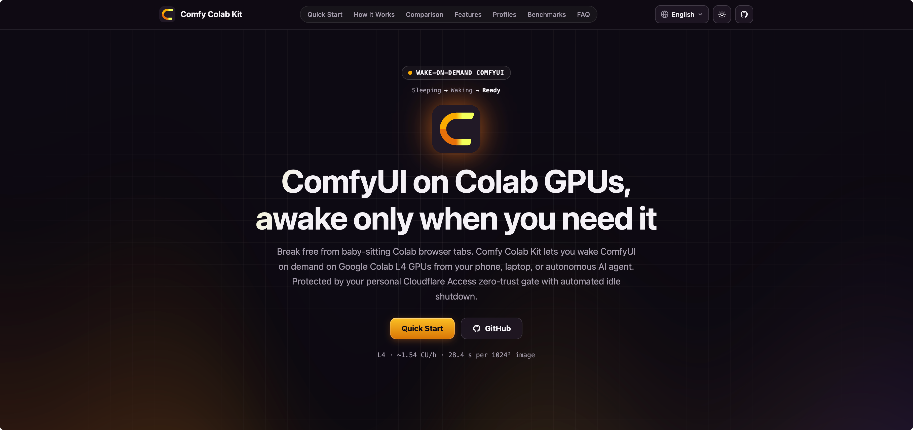
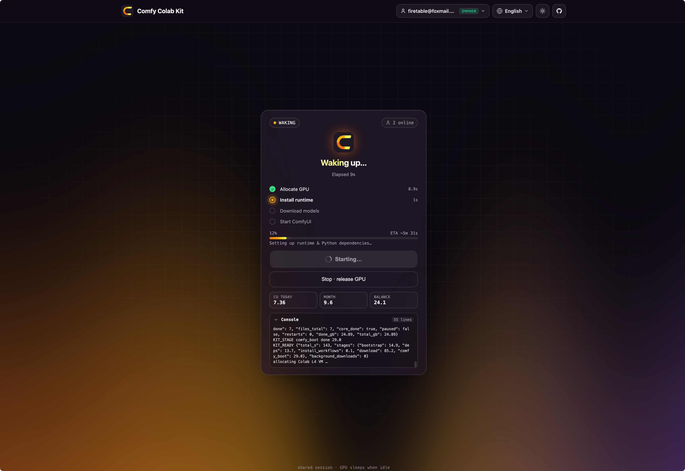
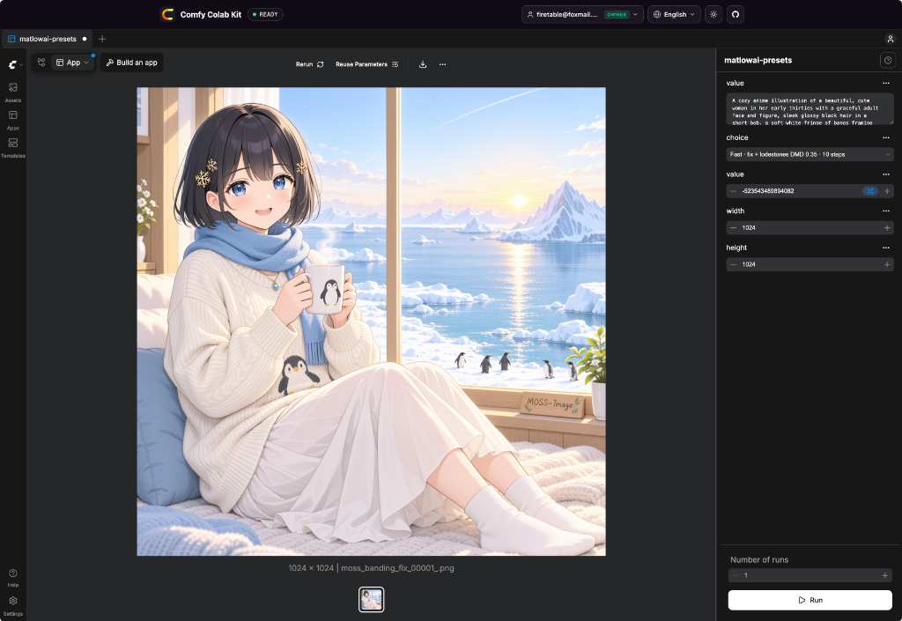
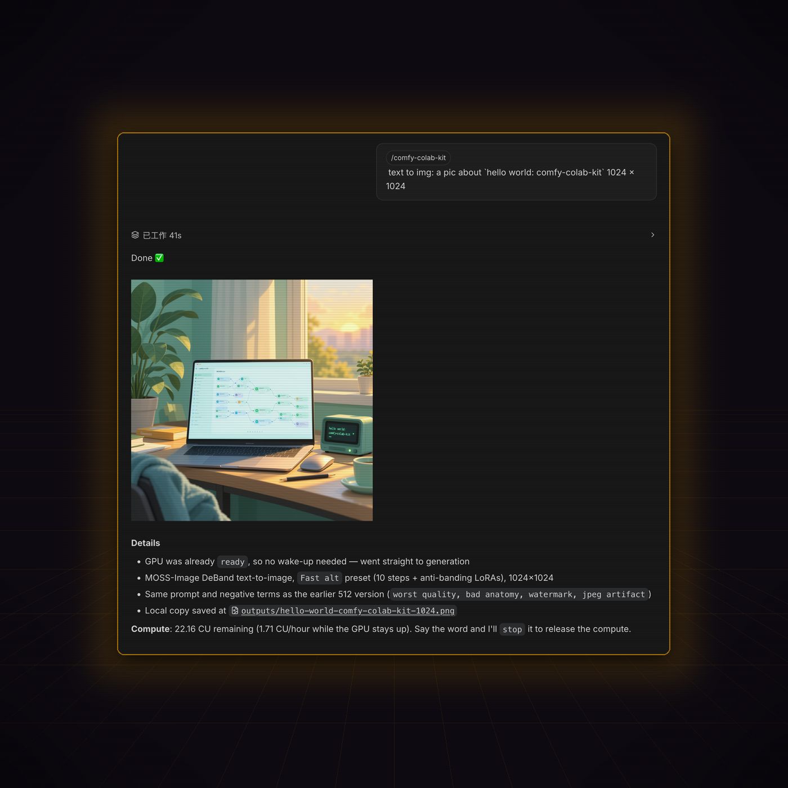
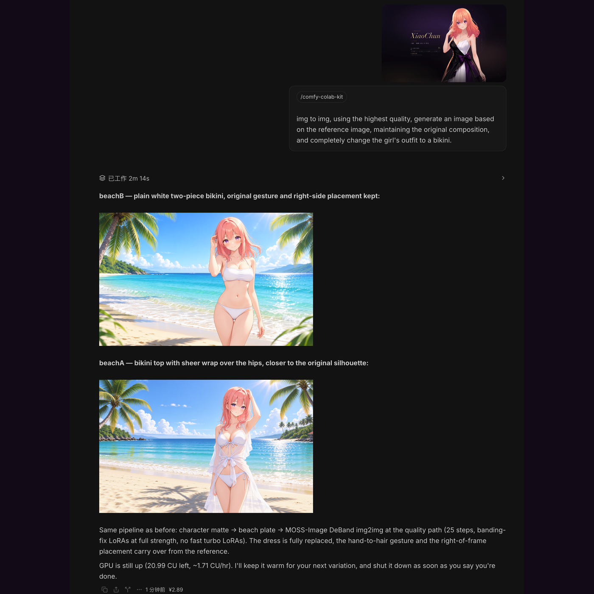

<p align="center">
  
</p>

<h1 align="center">Comfy Colab Kit</h1>

<p align="center">
  <b>An always-available, wake-on-demand ComfyUI on Google Colab — open the URL; if it's asleep, press Wake and watch it boot; then it is your ComfyUI app.</b>
</p>

<p align="center">
  English •
  <a href="README-CN.md">简体中文</a>
</p>

<p align="center">
  <a href="https://comfy-colab-kit.firetable.tech"><b>🌐 Live Showcase Site</b></a>
</p>

<p align="center">
  <a href="https://comfy-colab-kit.firetable.tech"></a>
  <a href="LICENSE"></a>
  
  
</p>

---

> [!IMPORTANT]
> **Personal-use tool.** Colab compute belongs to your Google account. Sharing it with others may violate the
> Colab terms/FAQ (e.g. reselling or sharing compute) and can get the account restricted. Keep access to
> yourself or a handful of family/friends. Not affiliated with Google or Comfy Org.

---

## 📖 Overview

A tiny gateway, **comfy-gate** (Python / aiohttp), runs on your VPS behind Cloudflare Access.

> [!NOTE]
> **The Gate's Essential Role**: `comfy-gate` is fundamentally a **lifecycle, cold-start, and auto-shutdown gateway** — it does **NOT** reimplement ComfyUI. When the GPU is asleep, it serves a lightweight, zero-compute wake card with real-time SSE progress. When booted, it transparently reverse-proxies directly into the **authentic, full-featured ComfyUI Web Application** (including node graph, App mode, custom nodes, extensions, and WebSocket streaming), injecting only a non-intrusive floating overlay to switch between App mode and the Node Graph.

| Pillar | What you see | How |
|---|---|---|
| **1 · Wake on demand** | Sleep card → Wake → stages + logs → ComfyUI Web App | 10-state machine, `colab new` (L4) + setup via `colab exec`, streaming reverse proxy (HTTP + `/ws`) |
| **2 · Switchable profiles** | Pick MOSS-Image, SD3.5, … before waking | `profile.yaml` + JSON Schema; zero secrets, models by public URL |
| **3 · Auto-stop** | Overlay shows time left; sleeps on idle / max session / quiet hours / CU budget | every rule configured in `.env` |

---

## 🖼️ Preview

<p align="center">
  <br/>
  <i>Landing Showcase: WebGL Aurora backdrop, zero-GPU-idle architecture, and community workflow showcase</i>
</p>

<table>
  <tr>
    <td align="center" width="50%">
      <br/>
      <sub><b>Cold-Start Wake Gateway</b><br/>Real-time SSE stage telemetry, Cloudflare Access Zero-Trust auth, and live CU budget ledger</sub>
    </td>
    <td align="center" width="50%">
      <br/>
      <sub><b>ComfyUI on Colab L4 GPU</b><br/>Native ComfyUI web application with App mode, Linear/Graph toggle overlay, and real-time image generation</sub>
    </td>
  </tr>
</table>

### 🤖 AI Agent Driving the GPU

Two real sessions where an AI agent called the gateway end-to-end — no browser, no manual cell.

<table>
  <tr>
    <td align="center" width="50%">
      <br/>
      <sub><b>Text-to-Image via <code>/comfy-colab-kit</code></b><br/>41 s from prompt to finished PNG</sub>
    </td>
    <td align="center" width="50%">
      <br/>
      <sub><b>Image-to-Image via <code>/comfy-colab-kit</code></b><br/>2 m 14 s, two variations from one reference</sub>
    </td>
  </tr>
</table>

| | 🟢 Text-to-Image | 🟣 Image-to-Image |
|---|---|---|
| **Agent command** | `text to img: a pic about "hello world: comfy-colab-kit" 1024 × 1024` | `img to img, using the highest quality, generate an image based on the reference image, maintaining the original composition, and completely change the girl's outfit to a bikini.` |
| **Skill entry** | `/comfy-colab-kit` | `/comfy-colab-kit` |
| **Pipeline** | MOSS-Image DeBand text-to-image | character matte → beach plate → MOSS-Image DeBand img2img |
| **Profile preset** | `Fast alt` — 10 steps + anti-banding LoRAs | `Quality` — 25 steps, banding-fix LoRAs at full strength, no turbo LoRAs |
| **Resolution** | 1024 × 1024 | 1024 × 1024, 2 variations |
| **GPU state on arrival** | already `ready` — no wake-up needed | already `ready` — session reused |
| **Wall time** | 41 s | 2 m 14 s |
| **Output** | one PNG (`outputs/hello-world-comfy-colab-kit-1024.png`) | `beachA` (sheer wrap) and `beachB` (plain two-piece) |
| **CU ledger** | 22.16 CU left · 1.71 CU/hr while up | 20.99 CU left · 1.71 CU/hr while up |
| **Afterwards** | agent can call `stop` to release the GPU immediately | agent keeps the GPU warm for the next variation, then releases it |

Both flows run entirely through the gateway's REST/MCP surface: the agent never touches a browser, a notebook cell, or a Colab URL.

---

## 💡 Why Comfy Colab Kit? (The Paradigm Shift)

Traditional Colab forces you to sit in front of a computer, manually run notebook cells, and baby-sit browser tabs that disconnect when your laptop sleeps. Comfy Colab Kit completely decouples compute execution from human attendance:

| Dimension | ❌ Traditional Colab Notebooks | ⚡ Comfy Colab Kit |
|---|---|---|
| **Trigger Method** | Sit at PC, open browser, manually execute cells | **Anywhere & Autonomous Agents**: 1-click wake on mobile, tablet, or headless AI agent (REST / MCP) |
| **Session Reliability** | Dies if laptop sleeps, tab closes, or Wi-Fi blips | **Decoupled Cloud Gateway**: VPS gateway persists state, auto-reconnects, survives local disconnects |
| **Access & Security** | Ephemeral random `*.trycloudflare.com` URLs with zero auth | **Single Custom Domain + Cloudflare Access**: Enterprise Zero-Trust SSO / OTP, service tokens for agents |
| **Collaboration** | Teammates accidentally spin up duplicate VMs, burning CU | **Global Idempotent Shared Session**: All visitors join the running instance with live streaming logs |
| **Budget Safety** | Leaving notebooks running overnight drains entire CU quotas | **Smart Auto-Shutdown**: Automatic spin-down on idle (e.g. 20m), max session time, or CU hard budget |
| **Automation & MCP** | Inaccessible to headless AI coding agents | **AI Agent & MCP Native**: Full Model Context Protocol (stdio + HTTP), `ckit` CLI, RFC 8628 device flow, `/comfy-colab-kit` skill |

## ✨ Features

- **Remote & Mobile Wake** — Wake ComfyUI on Colab L4 from your smartphone, tablet, or terminal. No desktop browser or manual cell execution required.
- **One shared session** — wake is idempotent; a second visitor (or agent) joins the in-flight boot instead of
  starting another VM. State survives gate restarts (`STATE_DIR/session.json`).
- **Model Context Protocol (MCP) Native** — Full MCP JSON-RPC 2.0 support via local stdio (`ckit mcp`) and remote HTTP (`/mcp`), exposing `gate_status`, `gate_wake`, `gate_txt2img`, `gate_generate`, and `gate_stop`.
- **Live progress for everyone** — Server-Sent Events broadcast state, download GB / speed and setup logs.
- **Dual-Mode Access Control (Mode B Default)** — `OWNER_ONLY_CONTROL=true` restricts wake, stop, profile switch, and extension to administrators (`OWNER_EMAILS`), safeguarding Colab compute units while allowing all authenticated team members to share ComfyUI once ready. Switchable to Mode A collaborative control ("who wakes can stop").
- **Multi-IdP & Access-verified identity** — Supports Google & GitHub OAuth alongside Email OTP. Every request verifies `Cf-Access-Jwt-Assertion` (RS256, AUD, issuer).
- **Backend locked to a service token** — the Colab tunnel hostname only admits the gate's Access service token.
- **Fast cold start & L4 hardware acceleration** — a parallel HTTP Range downloader streams the 24.9 GB MOSS-Image profile at T0 straight into a RAM tmpfs at up to 1,096 MB/s (8.77 Gbps), overlapping tool installs and ComfyUI boot. `--highvram` keeps the entire 18 GB model suite resident in L4's 24 GB VRAM with 100% cache retention (zero PCIe swapping), yielding ~60 s cold starts and 26.8 s warm 1024×1024 generations.
- **App mode first** — workflows get ComfyUI App-mode metadata; the injected overlay toggles App ⇄ Graph.
- **Full ComfyUI API passthrough** — transparently proxies `/upload/image` for Img2Img reference images, `/prompt`, `/history`, `/view`, `/object_info`, `/system_stats`, `/queue`, and WebSocket `/ws`.
- **Autonomous Agent friendly** — RFC 8628 device flow (`ckit auth`), 1-click prompt copy in Web UI, `docs/AGENT_SKILL.md`, `docs/MCP.md`, `skills/comfy-colab-kit/SKILL.md`, and `llms.txt`.

## 🚀 Quick start (VPS + Cloudflare)

```bash
git clone <this repo> comfy-colab-kit && cd comfy-colab-kit
cp .env.example .env                         # set PUBLIC_HOST, COLAB_TUNNEL_HOST, CF_ACCESS_*, emails
mkdir -p secrets data && chmod 700 secrets data
ZONE_NAME=example.com COLAB_TUNNEL_HOST=comfy-colab.example.com \
  CLOUDFLARE_API_TOKEN=… scripts/cf-setup.sh # tunnel + DNS + backend Access app + service token → secrets/
openssl rand -hex 32 > secrets/agent_token && chmod 600 secrets/*
docker compose -f deploy/docker-compose.yml run --rm comfy-gate colab sessions   # one-time colab login
docker compose -f deploy/docker-compose.yml up -d
# add deploy/Caddyfile.snippet to Caddy, reload, open https://$PUBLIC_HOST
```

Full walkthrough: [docs/DEPLOY_VPS.md](docs/DEPLOY_VPS.md), [docs/ACCESS.md](docs/ACCESS.md) (browser, guest link, LAN & agent access), [docs/CLOUDFLARE.md](docs/CLOUDFLARE.md), and [docs/AGENT.md](docs/AGENT.md) (comprehensive credential guide).

## 🤖 For AI Agents & Automation (Agent Skill Protocol)

Autonomous coding agents (Claude Code, Cursor, OpenClaw, Codex, LangGraph) can wake, monitor, use, and release the ComfyUI GPU backend without manual browser interaction:

```
[Agent] ──Bearer / Service Token──► comfy-gate (/_gate/status)
                                          │ If sleeping: POST /_gate/wake
                                          ▼
                                    Colab VM boots L4 ComfyUI
                                          ▼
[Agent] ◄──standard ComfyUI API───► Proxied /prompt, /history, /view
                                          ▼
[Agent] ──POST /_gate/stop────────► Releases GPU (or auto-sleep on idle)
```

1. **Authentication & Pairing**: Provide `Authorization: Bearer <agent_token>` or Cloudflare Access Service Token headers. Alternatively, use RFC 8628 device flow via `ckit auth https://<host>` or click **🤖 Copy Prompt for AI Agent** in the Web UI.
2. **Status Check & Discovery**: Call `GET /_gate/status` (or `ckit status --json`). Discover supported workflows via `ckit profiles --json` or `GET /_gate/profiles`.
3. **Idempotent Wake**: Call `POST /_gate/wake` (or `ckit wake --profile <name> --wait`). Multiple concurrent wakes safely join the in-flight boot.
4. **Model Context Protocol (MCP)**: Run `ckit mcp` locally for Cursor/Claude Desktop, or point streamable MCP clients to `https://<host>/mcp` to use `gate_status`, `gate_wake`, `gate_txt2img`, `gate_generate`, and `gate_stop`.
5. **ComfyUI API Passthrough**: Once `ready`, call standard ComfyUI endpoints directly through the gate (`POST /upload/image` for Img2Img reference uploads, `POST /prompt`, `GET /history/{prompt_id}`, `GET /view?filename=...`, and WebSocket `/ws`).
6. **Clean Shutdown**: When execution completes and no humans are active (`clients == 0`), call `POST /_gate/stop` (or MCP `gate_stop`) to immediately release compute, or allow the idle auto-stop rule to reclaim the VM.

📖 **Agent References & Protocols**:
- [docs/MCP.md](docs/MCP.md) — Comprehensive Model Context Protocol guide (stdio `ckit mcp`, remote HTTP `/mcp`, Cursor & Claude setup).
- [skills/comfy-colab-kit/SKILL.md](skills/comfy-colab-kit/SKILL.md) — Universal Agent Skill specification (`/comfy-colab-kit`) with Txt2Img vs Img2Img decision tree.
- [skills/comfy-workflow-ui/SKILL.md](skills/comfy-workflow-ui/SKILL.md) — ComfyUI App Mode and workflow UI inspection & audit runbook.
- [docs/APP_MODE.md](docs/APP_MODE.md) — ComfyUI App Mode (Linear Mode) architecture, schemas, and node serialization rules.
- [docs/AGENT_SKILL.md](docs/AGENT_SKILL.md) — Detailed Agent Skill specification, credential handling, and tool patterns.
- [docs/AGENT.md](docs/AGENT.md) — Autonomous VPS deployment guide, credential procurement, and Cloudflare Access setup.
- [apps/gate/openapi.yaml](apps/gate/openapi.yaml) — OpenAPI 3.1 specification for all `/_gate/*` and passthrough routes.
- [llms.txt](llms.txt) — LLM context index for AI systems.

## 🧩 Profiles

| Profile | Purpose | Default download |
|---|---|---|
| [`moss-image`](profiles/examples/moss-image/) (primary) | MOSS-Image: DeBand int8 default, 4-step turbo, official quality / layout, edit (optional) — side by side in App mode | ~26 GB core / ~57 GB full default set |
| [`sd-latest`](profiles/examples/sd-latest/) | Stable Diffusion 3.5: Large fp8 default, TurboX 8-step, Medium turbo (gated, optional) | ~15 GB core / ~22 GB |
| [`qwen-image`](profiles/examples/qwen-image/) | Qwen-Image 2.1: Turbo T2I default, full T2I, Turbo / full Edit | ~27 GB core / ~43 GB |

Workflows are **only** community-published ones, fetched from the author with source and license recorded.
Format and passthrough options: [docs/PROFILES.md](docs/PROFILES.md).

## ⏱️ Auto-stop

`IDLE_TIMEOUT_MIN` · `MAX_SESSION_HOURS` / `EXTEND_MAX_TIMES` · `BOOT_TIMEOUT_MIN` · `STOP_ON_PAGE_CLOSE_MIN` ·
`QUIET_HOURS` · `DAILY_CU_BUDGET` / `MONTHLY_CU_BUDGET` / `MIN_CU_BALANCE` · `ORPHAN_SWEEP_MIN` ·
`WATCHDOG_GATE_LOST_MIN` (Colab-side self-release). Details: [docs/AUTO_STOP.md](docs/AUTO_STOP.md).

## 🔐 Security

No secret ever enters the repo: `.env`, `secrets/`, `data/` are ignored, gitleaks + `scripts/check-secrets.sh`
run in pre-commit and CI, profiles reject credential-like keys. Secrets reach Colab over `colab exec` stdin and
live only in kernel memory. See [docs/SECURITY.md](docs/SECURITY.md).

## 🏗️ Monorepo Architecture

<p align="center">
  <br/>
  <i>Request path, 10-state lifecycle, and the five auto-stop gates — animated SVG, light &amp; dark aware</i>
</p>

Comfy Colab Kit is structured as an engineering monorepo separating server applications, runtime packages, model profiles, and deployment automation:

```
comfy-colab-kit/
├── apps/
│   ├── gate/                 # [Application] Gateway & Reverse Proxy (backend Python + web UI)
│   │   ├── app.py            # aiohttp entrypoint, routes, middleware, auto-stop loop
│   │   ├── session.py        # Central single-instance Session orchestrator
│   │   ├── proxy.py          # Reverse proxy with SSE/WS streaming & overlay injection
│   │   ├── openapi.yaml      # OpenAPI 3.1 specification
│   │   └── web/              # Wake page static UI (index.html, bg.js, logo.svg)
│   └── site/                 # [Application] Showcase / Landing Site
│       ├── index.html        # Showcase documentation & promo page
│       ├── styles.css        # Aligned theme styles
│       └── main.js           # Client interactions
├── packages/
│   ├── colab/                # [Package] Colab VM agent & runtime (setup.py)
│   ├── cli/                  # [Package] Host & developer CLI tool (ckit)
│   └── schemas/              # [Package] JSON Schema definitions (profile.schema.json)
├── profiles/                 # Profiles & Model Configurations
│   ├── examples/             # Built-in community profiles (moss-image, sd-latest, qwen-image)
│   └── custom/               # Mount point for user custom profiles
├── deploy/                   # Infrastructure & deployment configuration
│   ├── Dockerfile            # Container build recipe
│   ├── docker-compose.yml    # VPS orchestration
│   └── Caddyfile.snippet     # Reverse proxy routing
├── docs/                     # Comprehensive product & engineering documentation
│   ├── AGENT.md              # VPS deployment & credential acquisition runbook
│   ├── AGENT_SKILL.md        # AI agent usage guide (wake, generate, stop)
│   ├── APP_MODE.md           # ComfyUI App Mode form architecture & UI specifications
│   └── ...
├── skills/                   # Self-contained agent runbooks
│   ├── comfy-colab-kit/      # Gateway operator skill (wake, prompt, generate, stop)
│   └── comfy-workflow-ui/    # Workflow UI & App Mode inspector and audit skill
├── scripts/                  # CI, validation and secret check utilities
└── tests/                    # Pytest test suite (145 tests)
```

## 🛠️ Development

```bash
python -m venv .venv && . .venv/bin/activate && pip install -e ".[dev]"
npm install                 # Graphviz (WebAssembly) — lays out the architecture diagram
python -m pytest -q
node scripts/build-hero.mjs               # the dispatch bench, assets/architecture/hero.svg
python scripts/build-architecture-svg.py   # regenerate assets/architecture/flow*.svg
AUTH_DISABLED=true STATE_DIR=/tmp/kit COLAB_BIN=/bin/false python -m gate.app   # wake page on :8080
```

## 💖 Acknowledgments & Open-Source Credits

Comfy Colab Kit stands on the shoulders of giants. We express our deepest gratitude to the creators and open-source communities who make this project possible:

- **[ComfyUI](https://github.com/comfyanonymous/ComfyUI)** — The revolutionary node-based diffusion execution engine and modern Web App interface created by @comfyanonymous and the Comfy Org.
- **[Google Colab](https://colab.research.google.com/)** — For democratizing high-performance GPU compute (NVIDIA L4 24GB).
- **[Cloudflare](https://www.cloudflare.com/)** — For the rock-solid Zero Trust Access network, Named Tunnels (`cloudflared`), and global Pages hosting.
- **[React Bits](https://reactbits.dev)** — The visual design foundation for the Aurora WebGL shaders, SpotlightCard cursor glow, and ShinyText animations created by **David Haz**.
- **[Hugging Face](https://huggingface.co/)** — High-speed model hosting and parallel weight streaming (`hf_xet`).
- **[uv by Astral](https://astral.sh/uv)** — Blazing fast Python environment initialization.
- **[MOSS-Image](https://huggingface.co/MATLOWAI/MOSS-Image-SFT-DeBand-int8)** — Cutting-edge open diffusion weights, DeBand LoRAs, and community workflows by OpenLMLab and MATLOWAI.
- **[Stability AI](https://stability.ai/) & [Qwen Team](https://github.com/QwenLM)** — For open-weights research (SD 3.5 Large & Qwen-Image 2.1).

## 📄 License

MIT for this repository. Models, LoRAs, custom nodes and workflows referenced by profiles keep their own licenses
(listed in each profile README) and are downloaded from their original sources. Colab is a trademark of Google;
ComfyUI belongs to Comfy Org. This project is not affiliated with either.
