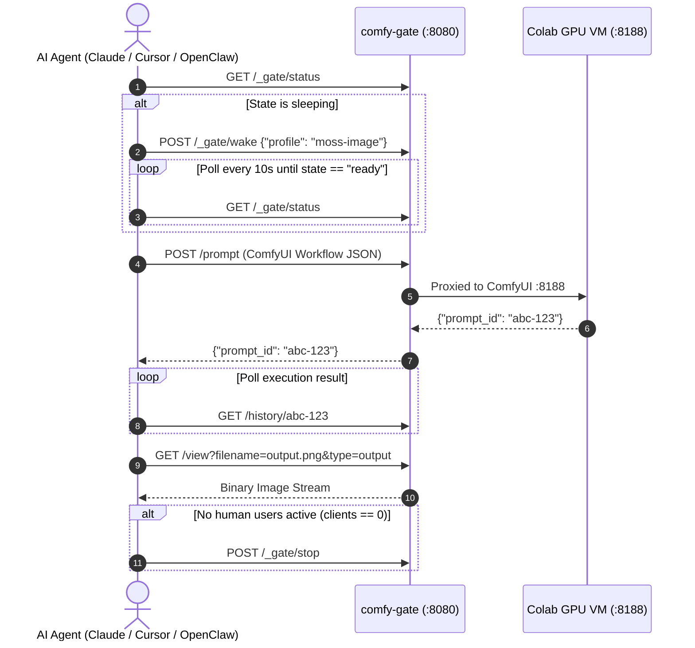

# User & Client Access Guide

Comfy Colab Kit provides flexible access paths tailored for end-users, team members, invited guests, command-line operators, and autonomous AI coding agents.

---

## 🧭 Access Matrix

| Client Type | Authentication Mechanism | Requirements | Typical Use Case |
|---|---|---|---|
| **Web Browser (Owner/Team)** | Cloudflare Zero Trust (Email OTP / SSO) | Email listed in `ALLOWED_EMAILS` | Daily generation on desktop or mobile browser |
| **Web Browser (Guest/Friend)** | URL Token parameter (`?token=...`) | Token in `secrets/agent_token` | Quick sharing with trusted friends without CF accounts |
| **Autonomous AI Agent** | HTTP Header `Authorization: Bearer <token>` | Token in `secrets/agent_token` | Claude Code, Cursor, OpenClaw, LangGraph automation |
| **Desktop AI Assistant** | Model Context Protocol (MCP JSON-RPC) | `packages/cli/mcp_server.py` | Claude Desktop, Cursor agent tool integration |
| **Terminal Operator** | CLI Tool (`packages/cli/ckit`) | `CKIT_URL` + `CKIT_TOKEN_FILE` | Server administration, CI/CD scripts, headless shells |
| **Private LAN / Tailscale** | Bypassed Auth (`AUTH_DISABLED=true`) | Protected internal network | Homelab, Tailscale mesh, local testing |

---

## 1. Web Browser Access (Cloudflare Zero Trust for Humans)

The recommended production configuration places `PUBLIC_HOST` behind Cloudflare Access.

### 1.1 Supported Identity Providers (IdP)
Cloudflare Zero Trust supports multiple simultaneous login methods on the login screen:
1. **GitHub One-Click Login (OAuth App)**:
   - Create a GitHub OAuth App at [GitHub Developer Settings](https://github.com/settings/applications/new):
     - **Application Name**: `Comfy Colab Kit`
     - **Homepage URL**: `https://comfy.yourdomain.com`
     - **Authorization callback URL**: `https://<team-domain>.cloudflareaccess.com/cdn-cgi/access/callback`
   - In Cloudflare Zero Trust (**Settings** > **Authentication** > **Add IdP** > **GitHub**):
     - Enter the generated `Client ID` and `Client Secret`.
2. **Google One-Click Login (OAuth 2.0)**:
   - In Google Cloud Console, create OAuth 2.0 Client Credentials with authorized redirect URI:
     - `https://<team-domain>.cloudflareaccess.com/cdn-cgi/access/callback`
   - In Cloudflare Zero Trust (**Settings** > **Authentication** > **Add IdP** > **Google**):
     - Enter the `Client ID` and `Client Secret`.
3. **One-Time PIN (Email OTP)**:
   - Default built-in provider. Supports any email domain (QQ 邮箱, Foxmail, Gmail, 163, Outlook, etc.).

### 1.2 Access Policies & The "Missing OTP Email" Pitfall
> [!IMPORTANT]
> **Why do some emails (e.g. QQ 邮箱) not receive OTP codes?**
> Cloudflare Access enforces a strict anti-enumeration security policy: **If an entered email does not match any configured Access Policy, Cloudflare silently refuses to dispatch the OTP email**.
> - **Open Access Mode (`Everyone`)**: If you want anyone with a valid email or social login to access the site, set Policy:
>   - **Action**: `Allow`
>   - **Include**: `Everyone`
> - **Domain Whitelist**: To allow all users of specific mail providers:
>   - **Include**: `Email Domain: qq.com`, `Email Domain: foxmail.com`, `Email Domain: gmail.com`
> - **Explicit Email List**: To strictly restrict to designated addresses:
>   - **Include**: `Emails: alice@example.com, bob@example.com`

### 1.3 Unified Multi-Domain Application (Eager Redirect Cookie)
When ComfyUI reaches `state: ready`, `PUBLIC_HOST` (e.g. `comfy.yourdomain.com`) embeds `COLAB_TUNNEL_HOST` (e.g. `comfy-colab.yourdomain.com`) inside an `<iframe>`.
Instead of creating two separate Cloudflare Access applications (which causes cross-subdomain cookie isolation and CSP `frame-ancestors 'none'` blocks in modern browsers), **group both hostnames under a single Multi-Domain Access Application** with **Eager redirect cookie** enabled:
1. In Cloudflare Zero Trust (**Access** > **Applications**), open your app (`comfy-colab-kit`).
2. Under **Public hostnames**, add both hostnames:
   - `comfy.yourdomain.com`
   - `comfy-colab.yourdomain.com`
3. Ensure **Eager redirect cookie** is enabled (`true`).

When any user logs into `comfy.yourdomain.com`, Cloudflare automatically chains a background redirect to set authorization cookies on both hostnames simultaneously. When ComfyUI becomes ready, the iframe renders smoothly without triggering secondary login prompts!

### 1.4 Gateway Access Control Modes (Mode B Default vs. Mode A)

Because Google Colab GPU Compute Units (CU) represent real financial cost, `comfy-gate` provides granular permission governance:

#### 🛡️ Mode B: Owner-Only Control (Default, `OWNER_ONLY_CONTROL=true`)
In Mode B (production default), **only administrators listed in `OWNER_EMAILS` can wake or stop the GPU instance**:
- **Why this is default**: Prevents teammates, guests, or automated web crawlers from accidentally burning Colab compute units or prematurely interrupting ongoing generation tasks.
- **Wake Protection**: For non-owner signed-in users, the "Wake" button on the sleep page is disabled with `opacity: 0.38` and an informative tooltip (`"仅管理员可开机唤醒 GPU"` / `"Wake is restricted to owners"`). Direct API calls to `POST /_gate/wake` return `403 Forbidden` (`owner_only`).
- **Stop Protection**: The "Stop" button is disabled for non-owners (`"仅开机者或管理员可关机释放 GPU"` / `"Stop is restricted to owners"`). Calls to `POST /_gate/stop` return `403 Forbidden`.
- **Shared Access When Ready**: Once an administrator wakes the instance and it reaches `READY`, **all authenticated team members** (logged in via Google, GitHub, or Email OTP) have full access to ComfyUI. They can queue prompts, inspect workflows, and generate images concurrently without restriction!

#### 🤝 Mode A: Collaborative Control (`OWNER_ONLY_CONTROL=false`)
If you want an open collaborative environment where any authenticated team member can start the GPU:
- Set `OWNER_ONLY_CONTROL=false` in `.env`.
- **Anyone Can Wake**: Any user who passes Cloudflare Access (or has an agent token) can click "Wake" to start the instance.
- **Initiator Shutdown ("谁开谁关")**: When a user wakes the session, the gateway records their verified email (`woken_by`) and client IP (`woken_by_ip`).
- **Shutdown Authority**: Only the person who woke the instance (or a super-admin in `OWNER_EMAILS`) can stop it. For other users, the Stop button is disabled, preventing teammates from accidentally killing someone else's active session.

#### Configuration Reference
- **`OWNER_ONLY_CONTROL`**: `true` (default: Mode B) or `false` (Mode A).
- **`OWNER_EMAILS`**: Comma-separated admin emails (e.g. `you@example.com`). If empty, all signed-in users are treated as owners.
- **`OWNER_ONLY_ACTIONS`**: Configurable subset of actions restricted to owners: `wake,stop,switch,extend` (defaults to all four when `OWNER_ONLY_CONTROL=true`).
- **`ALLOWED_EMAILS`**: Optional secondary whitelist on the gateway; leave empty to permit anyone approved by Cloudflare Access.

---

## 2. Guest & Friend Access via URL Token (`?token=...`)

If you want to share access with a colleague or friend without adding their email to your Cloudflare Zero Trust organization:

1. Retrieve or generate your agent token:
   ```bash
   cat secrets/agent_token
   ```
2. Share the authenticated gateway link:
   ```
   https://comfy.yourdomain.com/?token=YOUR_AGENT_TOKEN
   ```
3. When the visitor opens this link:
   - The gateway validates the token parameter using timing-safe comparison.
   - It sets a secure, HTTP-only `agent_token` cookie for all subsequent requests.
   - The guest is immediately treated as an authorized client.

> [!NOTE]
> For the URL token to reach the gateway, ensure Cloudflare Access either has a bypass rule for the query parameter/path, or provide access via an alternate origin/Tailscale domain.

---

## 3. Disabling Authentication & Complete Bypass

If you want to completely disable login prompts so that anyone (or friends on your network) can access the gateway without entering an email OTP, configure Bypass on your Cloudflare Access Application and the VPS gateway:

### 🛠️ Step-by-Step Setup:

#### Step 1: Cloudflare Zero Trust (Configure Bypass Policy)
In [Cloudflare Zero Trust](https://one.dash.cloudflare.com/) > **Access** > **Applications**:
1. Open your Multi-Domain application (`comfy-colab-kit`):
   - Go to **Policies** > **Add a policy**.
   - Name: `Bypass-All` · Action: **Bypass** · Include: **Everyone** (Order: 1st priority).
   - Save policy.

*(Alternative: You can simply click `...` next to the application in the Cloudflare application list and select **Disable**).*

#### Step 2: VPS Gateway (Allow Unsigned Requests)
In `.env` on your VPS, activate `AUTH_DISABLED=true`:
```bash
# Enable auth bypass and restart gateway container
sed -i 's/^# *AUTH_DISABLED=.*/AUTH_DISABLED=true/' /opt/comfy-colab-kit/.env
cd /opt/comfy-colab-kit && docker compose --env-file .env -f deploy/docker-compose.yml up -d
```
All incoming requests will be automatically authorized as the default owner (`dev@localhost`).

> [!WARNING]
> Bypassing access allows anyone with the URL to wake the Colab VM and consume Compute Units. For public instances, it is strongly recommended to keep Cloudflare Access enabled or use the [Shareable Token Link](#2-guest--friend-access-via-url-token-token) pattern instead.

### 🔄 Restoring Zero Trust Protection
1. In your Multi-Domain Access Application (`comfy-colab-kit`), remove or disable the `Bypass-All` policy. Ensure your standard policies exist:
   - **Policy 1** (`Service Auth`): `gate service token only` (non-identity for the gateway's service token).
   - **Policy 2** (`Allow`): `Everyone Authenticated` (or restricted to `ALLOWED_EMAILS`).
2. **VPS Gateway**: Set `AUTH_DISABLED=false` (or remove it) in `.env` and restart the container (`docker compose up -d`).

---

## 4. AI Agents & Autonomous Workflows (REST & MCP)

Autonomous AI coding agents (Claude Code, Cursor, OpenClaw, LangGraph) can interact with the gateway programmatically.

### 4.1 How Agents Traverse Cloudflare Access
When `PUBLIC_HOST` is protected by Cloudflare Access, incoming programmatic requests must authenticate through Cloudflare at the network edge before reaching `comfy-gate`.

Choose one of three production patterns:

```mermaid
flowchart TD
    subgraph Pattern1 ["Pattern A: Direct / Tailscale / LAN (Recommended)"]
        AgentA["AI Agent"] -->|Direct HTTP + Bearer Token| GateA["comfy-gate:8080\n(Bypasses Cloudflare Edge)"]
    end

    subgraph Pattern2 ["Pattern B: Cloudflare Service Token (Public Web)"]
        AgentB["AI Agent"] -->|CF-Access-Client-Id\nCF-Access-Client-Secret\nBearer Agent Token| CFAccess["Cloudflare Access\n(Service Auth Policy)"]
        CFAccess --> GateB["comfy-gate:8080"]
    end

    subgraph Pattern3 ["Pattern C: Cloudflare Access Bypass Rule"]
        AgentC["AI Agent\n(Static IP or CIDR)"] -->|Bearer Agent Token| CFBypass["Cloudflare Access\n(Bypass by IP Policy)"]
        CFBypass --> GateC["comfy-gate:8080"]
    end
```



#### Pattern A: Direct Internal / Tailscale Network (Recommended)
- Configure the Agent to connect directly to the VPS internal origin:
  ```bash
  export CKIT_URL="http://100.64.0.1:8080" # Tailscale IP or private LAN
  ```
- **Headers**: Only requires `Authorization: Bearer <YOUR_AGENT_TOKEN>`.
- Completely avoids Cloudflare Access overhead, redirects, and edge quotas.

#### Pattern B: Cloudflare Service Token (For Public Agents)
If your agent runs on external cloud infrastructure (e.g. GitHub Actions, modal, Modal, AWS):
1. In Cloudflare Zero Trust (**Access** > **Service Auth**), generate a Service Token (gives Client ID and Client Secret).
2. In Cloudflare Access Applications (**`comfy-colab-kit`** > **Policies**):
   - Add a Policy: Name `Agent Service Auth` · Action: `Service Auth` · Include: `Service Token: <name>`.
3. Agent includes all three headers on every request:
   ```http
   CF-Access-Client-Id: <YOUR_CF_CLIENT_ID>
   CF-Access-Client-Secret: <YOUR_CF_CLIENT_SECRET>
   Authorization: Bearer <YOUR_AGENT_TOKEN>
   ```

#### Pattern C: Cloudflare Access IP Whitelist / Bypass
- In Cloudflare Access Applications (**`comfy-colab-kit`** > **Policies**):
  - Add a Policy with Action `Bypass` · Include: `IP Range: <Agent_Static_IP>/32`.
- The Agent sends `Authorization: Bearer <YOUR_AGENT_TOKEN>`.

### 4.2 Gateway-Side Agent Authentication
Once traffic reaches `comfy-gate`:
- The gate extracts the token from either:
  - Header: `Authorization: Bearer <TOKEN>`
  - Query Parameter: `?token=<TOKEN>`
- The token is compared with timing-safe hash comparison against `secrets/agent_token`.
- Valid agents receive `Identity(email="agent", role="agent", is_owner=True)` and are authorized to wake, generate, switch, extend, and stop sessions.

### 4.3 Standard Agent Execution Cycle


### 4.3 Model Context Protocol (MCP) Integration
Add comfy-colab-kit as an MCP tool in Claude Desktop, Cursor, or OpenClaw:

Edit `claude_desktop_config.json`:
```json
{
  "mcpServers": {
    "comfy-colab": {
      "command": "python3",
      "args": ["-m", "packages.cli.mcp_server"],
      "env": {
        "CKIT_URL": "https://comfy.yourdomain.com",
        "CKIT_TOKEN_FILE": "/path/to/secrets/agent_token"
      }
    }
  }
}
```

Exposed MCP Tools:
- `gate_status`: Inspect VM state, active profile, queue load, and remaining CU.
- `gate_wake`: Wake the Colab instance with a chosen profile.
- `gate_generate`: Submit a prompt graph, wait for completion, and return the image.
- `gate_stop`: Terminate the VM and release GPU compute.

---

## 5. Terminal CLI Access (`packages/cli/ckit`)

The bundled `ckit` utility offers a zero-dependency CLI for operators:

```bash
# Configure endpoint and credentials
export CKIT_URL="https://comfy.yourdomain.com"
export CKIT_TOKEN_FILE="./secrets/agent_token"

# Check status
packages/cli/ckit status --json

# Wake and wait until ready
packages/cli/ckit wake --profile moss-image --wait

# Extend session duration
packages/cli/ckit extend

# Stop the GPU VM
packages/cli/ckit stop
```

---

## 6. Using ComfyUI Once Ready (In-App Navigation)

When the session reaches `ready`, the gateway transparently reverse-proxies into the authentic ComfyUI Web Application.

### App Mode vs Node Graph
- **Default View**: Boot workflows default to clean **App mode** (`extra.linearMode = true`), exposing only prompt inputs and seed widgets.
- **Switch Views**: Click the floating **App ⇄ Graph** pill in the bottom-right corner, or press `Alt + M` (`Comfy.ToggleLinear`) to toggle between the simplified interface and the complete node graph.

### Floating Session Overlay
The injected bottom-right pill provides essential controls:
- **Countdown**: Shows remaining session time before auto-stop.
- **`+1h` Button**: Calls `POST /_gate/extend` to add an hour to the session.
- **`⏻ Stop GPU` Button**: Calls `POST /_gate/stop` to safely terminate the VM and halt CU burn.
