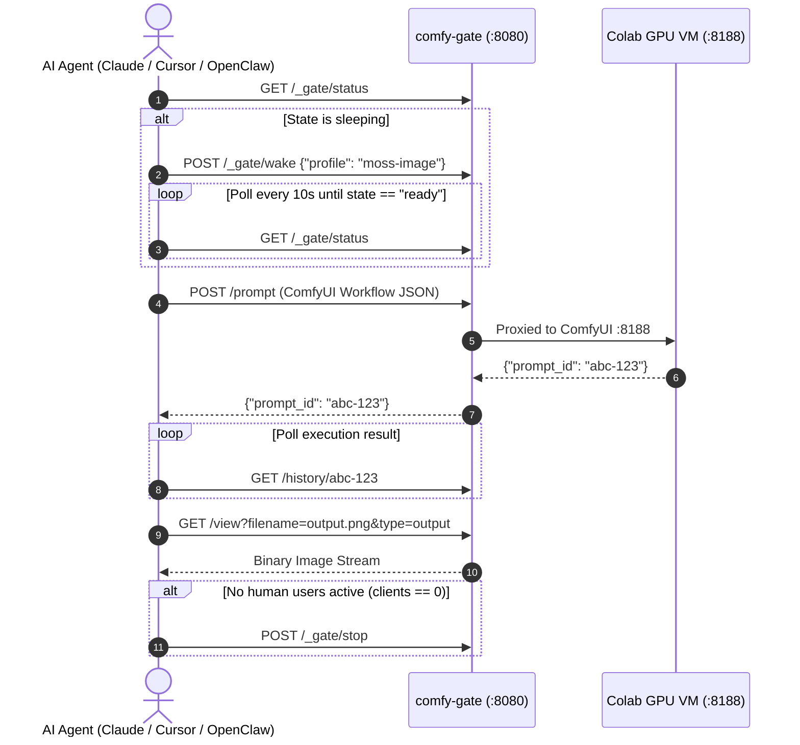

# User & Client Access Guide

Comfy Colab Kit provides flexible access paths tailored for end-users, team members, invited guests, command-line operators, and autonomous AI coding agents.

---

## 🧭 Access Matrix

| Client Type | Authentication Mechanism | Requirements | Typical Use Case |
|---|---|---|---|
| **Web Browser (Owner/Team)** | Cloudflare Zero Trust (Email OTP / SSO) | Email listed in `ALLOWED_EMAILS` | Daily generation on desktop or mobile browser |
| **Web Browser (Guest/Friend)** | URL Token parameter (`?token=...`) | Token in `secrets/agent_token` | Quick sharing with trusted friends without CF accounts |
| **Autonomous AI Agent** | HTTP Header `Authorization: Bearer <token>` | Token in `secrets/agent_token` | Claude Code, Cursor, OpenClaw, LangGraph automation |
| **Desktop AI Assistant** | Model Context Protocol (MCP JSON-RPC) | `packages/cli/mcp_server.py` | Claude Desktop, Cursor agent tool integration |
| **Terminal Operator** | CLI Tool (`packages/cli/ckit`) | `CKIT_URL` + `CKIT_TOKEN_FILE` | Server administration, CI/CD scripts, headless shells |
| **Private LAN / Tailscale** | Bypassed Auth (`AUTH_DISABLED=true`) | Protected internal network | Homelab, Tailscale mesh, local testing |

---

## 1. Web Browser Access (Cloudflare Zero Trust)

The recommended production configuration places `PUBLIC_HOST` behind Cloudflare Access.

### Login Flow
1. Open `https://comfy.yourdomain.com` in your browser (mobile or desktop).
2. Cloudflare Access prompts for your email address.
3. Enter your email and submit the 6-digit one-time passcode (OTP) received in your inbox.
4. Cloudflare issues a signed `CF_Authorization` cookie containing an RS256 JWT assertion (`Cf-Access-Jwt-Assertion`).
5. The gateway cryptographically validates the token against Cloudflare's public keys (`JWKS`).

### Permissions & Roles
- **All Authenticated Users (`ALLOWED_EMAILS`)**:
  - View current status, CU burn rate, and real-time boot logs.
  - Wake the default or selected model profile.
  - Use ComfyUI (App mode or Graph mode) once `ready`.
- **Owners (`OWNER_EMAILS`)**:
  - All standard permissions above.
  - Privileged actions: **Switch profile**, **Extend session (+1h)**, and **Stop GPU immediately**.
  - *Tip*: Leaving `OWNER_EMAILS` empty grants owner privileges to all authenticated users.

---

## 2. Guest & Friend Access via URL Token (`?token=...`)

If you want to share access with a colleague or friend without adding their email to your Cloudflare Zero Trust organization:

1. Retrieve or generate your agent token:
   ```bash
   cat secrets/agent_token
   ```
2. Share the authenticated gateway link:
   ```
   https://comfy.yourdomain.com/?token=YOUR_AGENT_TOKEN
   ```
3. When the visitor opens this link:
   - The gateway validates the token parameter using timing-safe comparison.
   - It sets a secure, HTTP-only `agent_token` cookie for all subsequent requests.
   - The guest is immediately treated as an authorized client.

> [!NOTE]
> For the URL token to reach the gateway, ensure Cloudflare Access either has a bypass rule for the query parameter/path, or provide access via an alternate origin/Tailscale domain.

---

## 3. Disabling Authentication & Complete Bypass (Dual-Host Bypass)

If you want to completely disable login prompts so that anyone (or friends on your network) can access the gateway without entering an email OTP, you **MUST configure Bypass on BOTH Cloudflare Access Applications and the VPS gateway**.

### ⚠️ Why Both Cloudflare Applications Must Be Configured:
Comfy Colab Kit utilizes a dual-hostname architecture:
1. **Frontend Gateway (`PUBLIC_HOST`, e.g. `comfy-colab-kit`)**: Serves the wake-on-demand card and telemetry. If this is not bypassed, visitors are stopped by the email OTP login screen when opening the site.
2. **Backend Tunnel (`COLAB_TUNNEL_HOST`, e.g. `comfy-colab-kit-backend`)**: Where the Colab VM's ComfyUI instance runs. When `state: ready`, the gateway embeds ComfyUI into the page via an `<iframe>` pointing directly to this backend host. **If this backend host is not also bypassed, the browser will be blocked from loading ComfyUI inside the iframe** (resulting in a blank iframe, 403 Forbidden, or login prompts inside the iframe).

### 🛠️ Step-by-Step Setup:

#### Step 1: Cloudflare Zero Trust (Configure Both Apps)
In [Cloudflare Zero Trust](https://one.dash.cloudflare.com/) > **Access** > **Applications**:
1. **Frontend App (`comfy-colab-kit` / `PUBLIC_HOST`)**:
   - Go to **Policies** > **Add a policy**.
   - Name: `Bypass-All` · Action: **Bypass** · Include: **Everyone**.
   - Save and ensure it has top priority.
2. **Backend App (`comfy-colab-kit-backend` / `COLAB_TUNNEL_HOST`)**:
   - Go to **Policies** > **Add a policy**.
   - Name: `Bypass-All` · Action: **Bypass** · Include: **Everyone**.
   - Save and ensure it has top priority.

*(Alternative: You can simply click `...` next to both applications in the Cloudflare application list and select **Disable**).*

#### Step 2: VPS Gateway (Allow Unsigned Requests)
In `.env` on your VPS, activate `AUTH_DISABLED=true`:
```bash
# Enable auth bypass and restart gateway container
sed -i 's/^# *AUTH_DISABLED=.*/AUTH_DISABLED=true/' /opt/comfy-colab-kit/.env
cd /opt/comfy-colab-kit && docker compose --env-file .env -f deploy/docker-compose.yml up -d
```
All incoming requests will be automatically authorized as the default owner (`dev@localhost`).

> [!WARNING]
> Bypassing both applications allows anyone with the URL to wake the Colab VM and consume Compute Units. For public instances, it is strongly recommended to keep Cloudflare Access enabled or use the [Shareable Token Link](#2-guest--friend-access-via-url-token-token) pattern instead.

---

## 4. AI Agents & Autonomous Workflows (REST & MCP)

Autonomous AI coding agents can interact with the gateway programmatically.

### 4.1 Authentication Header
Attach the Bearer token to all HTTP requests:
```http
Authorization: Bearer <YOUR_AGENT_TOKEN>
```

### 4.2 Standard Agent Execution Cycle


### 4.3 Model Context Protocol (MCP) Integration
Add comfy-colab-kit as an MCP tool in Claude Desktop, Cursor, or OpenClaw:

Edit `claude_desktop_config.json`:
```json
{
  "mcpServers": {
    "comfy-colab": {
      "command": "python3",
      "args": ["-m", "packages.cli.mcp_server"],
      "env": {
        "CKIT_URL": "https://comfy.yourdomain.com",
        "CKIT_TOKEN_FILE": "/path/to/secrets/agent_token"
      }
    }
  }
}
```

Exposed MCP Tools:
- `gate_status`: Inspect VM state, active profile, queue load, and remaining CU.
- `gate_wake`: Wake the Colab instance with a chosen profile.
- `gate_generate`: Submit a prompt graph, wait for completion, and return the image.
- `gate_stop`: Terminate the VM and release GPU compute.

---

## 5. Terminal CLI Access (`packages/cli/ckit`)

The bundled `ckit` utility offers a zero-dependency CLI for operators:

```bash
# Configure endpoint and credentials
export CKIT_URL="https://comfy.yourdomain.com"
export CKIT_TOKEN_FILE="./secrets/agent_token"

# Check status
packages/cli/ckit status --json

# Wake and wait until ready
packages/cli/ckit wake --profile moss-image --wait

# Extend session duration
packages/cli/ckit extend

# Stop the GPU VM
packages/cli/ckit stop
```

---

## 6. Using ComfyUI Once Ready (In-App Navigation)

When the session reaches `ready`, the gateway transparently reverse-proxies into the authentic ComfyUI Web Application.

### App Mode vs Node Graph
- **Default View**: Boot workflows default to clean **App mode** (`extra.linearMode = true`), exposing only prompt inputs and seed widgets.
- **Switch Views**: Click the floating **App ⇄ Graph** pill in the bottom-right corner, or press `Alt + M` (`Comfy.ToggleLinear`) to toggle between the simplified interface and the complete node graph.

### Floating Session Overlay
The injected bottom-right pill provides essential controls:
- **Countdown**: Shows remaining session time before auto-stop.
- **`+1h` Button**: Calls `POST /_gate/extend` to add an hour to the session.
- **`⏻ Stop GPU` Button**: Calls `POST /_gate/stop` to safely terminate the VM and halt CU burn.
