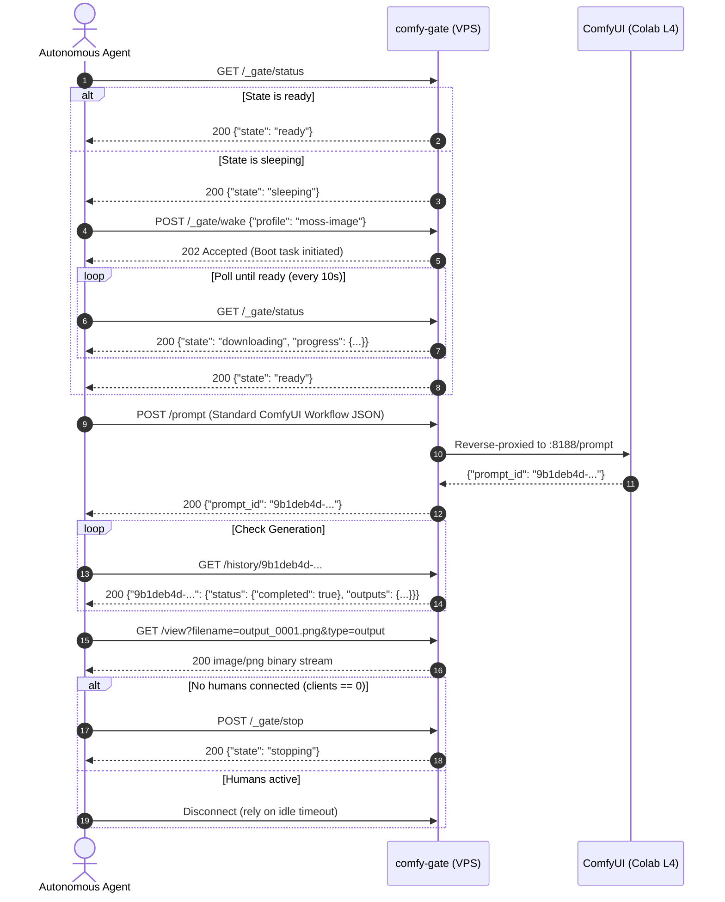

# Agent Skill: comfy-colab-kit gate (`comfy_colab_gate`)

This document defines an **Agent Skill** for autonomous AI coding agents (Claude Code, OpenClaw, Cursor agents, LangGraph, etc.) that need an on-demand ComfyUI GPU backend: wake the shared Colab L4 session, wait until ComfyUI is ready, execute image generation graphs via standard ComfyUI REST/WebSocket APIs, and cleanly release compute when finished.

---

## 1. Skill Metadata

- **Name**: `comfy_colab_gate`
- **Description**: Wake, monitor, prompt, and stop a ComfyUI-on-Colab instance behind a comfy-colab-kit gate.
- **Interface**: HTTPS JSON API ([API.md](API.md), [`apps/gate/openapi.yaml`](../apps/gate/openapi.yaml)), `packages/cli/ckit`, or Model Context Protocol (`packages/cli/mcp_server.py`).
- **Machine index**: [`llms.txt`](../llms.txt)

---

## 2. Credentials & Environment

| Item | Environment Variable | Transmission Method |
|---|---|---|
| Gate URL | `CKIT_URL=https://<PUBLIC_HOST>` | Base URL for all HTTP/SSE/WebSocket calls |
| Agent Token | `CKIT_TOKEN_FILE=/path/to/token` | Sent as `Authorization: Bearer <token>` |
| Cloudflare Service Token | `CF_ACCESS_CLIENT_ID` + `CF_ACCESS_CLIENT_SECRET_FILE` | Attached to bypass Cloudflare Access on `PUBLIC_HOST` (if configured) |

> [!IMPORTANT]
> Never print, log, or commit secret tokens. Agents authenticate as owners and have full permission to wake, prompt, extend, and stop sessions.

---

## 3. Tool Surface (`ckit` & REST)

```bash
# Query current session status and remaining compute units
packages/cli/ckit status --json

# List available profiles and community workflows
packages/cli/ckit profiles --json

# Wake or join the shared session (blocks until ComfyUI is ready)
packages/cli/ckit wake --profile moss-image --wait

# Extend session duration by +1 hour
packages/cli/ckit extend

# Stop the session immediately to release GPU compute
packages/cli/ckit stop

# Start Model Context Protocol (MCP) JSON-RPC stdio server
packages/cli/ckit mcp
```

Raw HTTP equivalents: `GET /_gate/status`, `GET /_gate/profiles`, `POST /_gate/wake`, `POST /_gate/stop`, `POST /_gate/mcp`; live telemetry on `GET /_gate/events` (SSE).

---

## 4. Autonomous Agent Execution Lifecycle



---

## 5. Concrete Workflow Execution Example

Once `GET /_gate/status` returns `"state": "ready"`, you interact with standard ComfyUI API routes through the gate.

### Step 1: Queue a Workflow Prompt
```bash
# Save your ComfyUI prompt JSON payload to /tmp/prompt.json
cat << 'EOF' > /tmp/prompt.json
{
  "prompt": {
    "3": {
      "inputs": {
        "seed": 42,
        "steps": 20,
        "cfg": 7.0,
        "sampler_name": "euler",
        "scheduler": "normal",
        "denoise": 1.0,
        "model": ["4", 0],
        "positive": ["6", 0],
        "negative": ["7", 0],
        "latent_image": ["5", 0]
      },
      "class_type": "KSampler"
    },
    "4": {
      "inputs": {"ckpt_name": "moss_image_sft_deband_int8_convrot.safetensors"},
      "class_type": "CheckpointLoaderSimple"
    },
    "5": {
      "inputs": {"width": 1024, "height": 1024, "batch_size": 1},
      "class_type": "EmptyLatentImage"
    },
    "6": {
      "inputs": {"text": "cinematic portrait of a cyberpunk explorer, neon lights, 8k", "clip": ["4", 1]},
      "class_type": "CLIPTextEncode"
    },
    "7": {
      "inputs": {"text": "blurry, low quality, artifacts", "clip": ["4", 1]},
      "class_type": "CLIPTextEncode"
    },
    "8": {
      "inputs": {"samples": ["3", 0], "vae": ["4", 2]},
      "class_type": "VAEDecode"
    },
    "9": {
      "inputs": {"filename_prefix": "AgentGen", "images": ["8", 0]},
      "class_type": "SaveImage"
    }
  }
}
EOF

# Submit to ComfyUI through the gate
PROMPT_RESP=$(curl -s -X POST "https://${PUBLIC_HOST}/prompt" \
  -H "Authorization: Bearer $(cat secrets/agent_token)" \
  -H "Content-Type: application/json" \
  -d @/tmp/prompt.json)

PROMPT_ID=$(echo "$PROMPT_RESP" | jq -r '.prompt_id')
echo "Queued prompt ID: $PROMPT_ID"
```

### Step 2: Poll for Output and Download
```bash
# Poll until prompt outputs appear in history
while true; do
  HIST=$(curl -s "https://${PUBLIC_HOST}/history/${PROMPT_ID}" \
    -H "Authorization: Bearer $(cat secrets/agent_token)")
  FILENAME=$(echo "$HIST" | jq -r ".\"${PROMPT_ID}\".outputs.\"9\".images[0].filename // empty")
  if [ -n "$FILENAME" ]; then
    echo "Generated filename: $FILENAME"
    break
  fi
  sleep 3
done

# Download the generated image
curl -s "https://${PUBLIC_HOST}/view?filename=${FILENAME}&type=output" \
  -H "Authorization: Bearer $(cat secrets/agent_token)" \
  -o generated_output.png
echo "Image downloaded to generated_output.png"
```

---

## 6. Policy Refusal Handling (HTTP 409)

When `POST /_gate/wake` returns `409 Conflict`, the response body includes a specific machine-readable `error` code. AI agents must execute the recommended recovery behavior rather than retrying in a tight loop:

| Error Code | Root Cause | Agent Action |
| :--- | :--- | :--- |
| `quiet_hours` | System is within configured quiet hours window (e.g. 23:00–08:00) | Abort execution; schedule wake task for after quiet hours end. Do not retry. |
| `daily_budget` | Today's Compute Unit quota has been exhausted | Notify human operator via notification channel. Cease wake attempts for today. |
| `monthly_budget` | Monthly Compute Unit quota has been exhausted | Notify human operator. Cease wake attempts until quota reset. |
| `low_balance` | Available Google Colab CU balance has dropped below `MIN_CU_BALANCE` | Notify human operator that Colab compute units need to be replenished. |
| `fetch_in_progress` | An on-demand model download is already underway | Wait 15 seconds and retry the request. |

---

## 7. Model Context Protocol (MCP) Configuration

To connect Claude Desktop, Cursor, or OpenClaw to your deployed gate via the native Model Context Protocol (MCP):

```json
{
  "mcpServers": {
    "comfy-colab": {
      "command": "python3",
      "args": ["-m", "packages.cli.mcp_server"],
      "env": {
        "CKIT_URL": "https://comfy.yourdomain.com",
        "CKIT_TOKEN_FILE": "/path/to/secrets/agent_token"
      }
    }
  }
}
```
Available MCP tools: `gate_status`, `gate_wake`, `gate_generate`, `gate_stop`.
