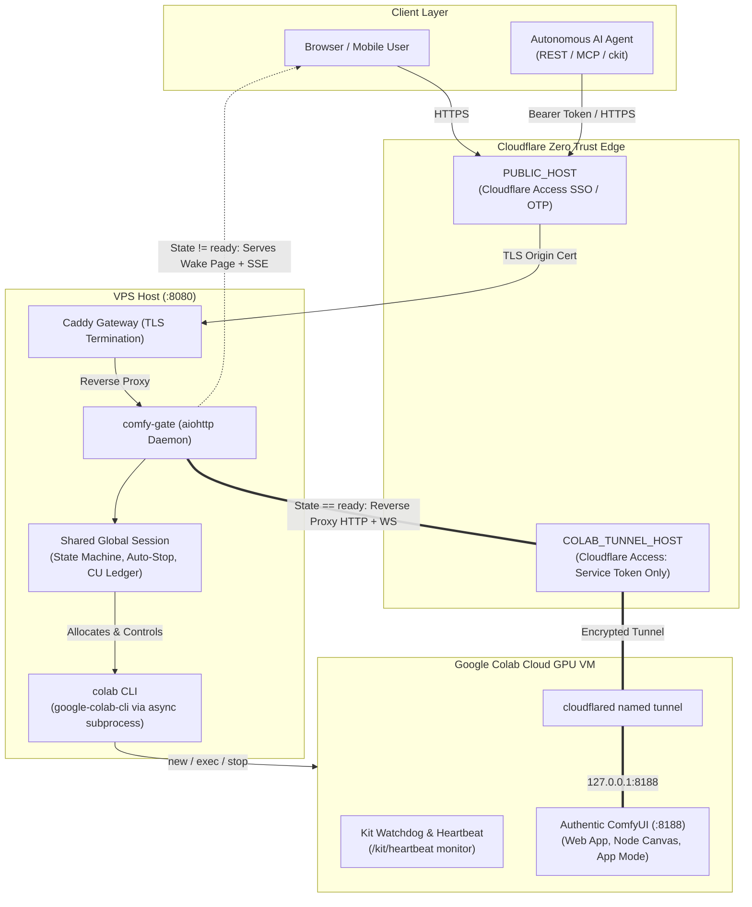
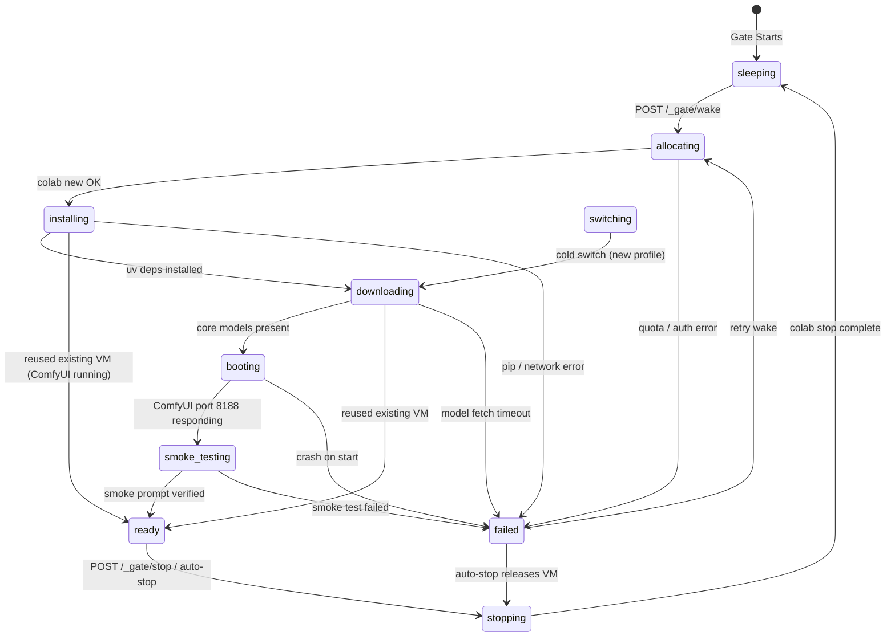

# Architecture Specification

Comfy Colab Kit operates as a **Dual-Phase Gateway**: it behaves as an orchestration gatekeeper during cold start and shutdown, and transforms into a transparent, low-overhead streaming reverse proxy the moment ComfyUI reaches the `ready` state.

---

## 1. Request Flow Architecture

---

## 2. Components (Monorepo Layout)

| Path | Role |
|---|---|
| `apps/gate/app.py` | aiohttp server: anti-bot middleware, auth middleware, `/_gate/*` routes, `/mcp` endpoint, catch-all proxy, 30s background loop |
| `apps/gate/session.py` | Central **single shared global session**: mutex lock, persistence, SSE broadcaster, boot orchestrator |
| `apps/gate/state.py` | 10-state machine transitions and billing state definitions |
| `apps/gate/stopper.py` | Pure auto-stop and wake-admission rules ([AUTO_STOP.md](AUTO_STOP.md)) |
| `apps/gate/budget.py` | Local CU ledger (per day / month tracking, balance cache) |
| `apps/gate/colab.py` | `ColabRunner` protocol + `ColabCLI` async wrapper around `google-colab-cli` |
| `apps/gate/proxy.py` | Streaming HTTP + WebSocket reverse proxy, overlay injection, queue / heartbeat probes |
| `apps/gate/auth.py` | Cloudflare Access JWT verification (JWKS cache), agent bearer token validation |
| `apps/gate/profiles.py`, `apps/gate/plan.py` | Profile parsing/validation and the JSON bootstrap plan sent to Colab |
| `apps/gate/web/` | Wake page (`index.html`), in-ComfyUI overlay (`overlay.js`), logo SVG |
| `packages/colab/setup.py` | Runs inside Colab kernel: dependency install, parallel downloads, ComfyUI boot, tunnel, watchdog, smoke test |
| `packages/cli/ckit` | Python stdlib CLI for operators and autonomous agents |
| `packages/cli/mcp_server.py` | Model Context Protocol (MCP) JSON-RPC 2.0 stdio server |
| `packages/schemas/profile.schema.json` | JSON Schema definitions for profile validation |
| `apps/site/` | Showcase & architecture documentation static website (Cloudflare Pages) |

---

## 3. The 10-State Machine & Billing Lifecycle

Every state transition is strictly validated through `apps/gate/state.py:TRANSITIONS` and atomically persisted to `data/state/session.json`.

> [!IMPORTANT]
> **Compute Unit (CU) Accrual**:
> Compute units accrue continuously whenever a Colab VM exists in Google's cloud. Therefore, **all boot states** (`allocating`, `installing`, `downloading`, `booting`, `smoke_testing`), **`ready`**, **`switching`**, and **`failed`** are designated as **billing states**. If a session enters `failed`, the gate's auto-stop engine promptly executes `colab stop` to prevent unintentional credit consumption.

---

## 4. Lifecycle Gate vs. ComfyUI Web Application

A key architectural principle of this project is separation of concerns:

- **What `comfy-gate` IS**:
  An intelligent **lifecycle gatekeeper**. It manages the state machine (`sleeping` ⇄ `ready`), handles authentication (Cloudflare Access JWT & Bearer tokens), boots Colab VMs on-demand via the Colab CLI, streams setup progress via SSE, tracks Compute Unit (CU) consumption, blocks malicious web scrapers, and enforces auto-stop rules (idle timeouts, max session caps, quiet hours).
- **What `comfy-gate` is NOT**:
  It is **not** a reimplementation of ComfyUI's user interface, graph renderer, or execution engine.
- **The Transition**:
  While the VM is booting or asleep, `GET /` serves the zero-compute wake page. The exact millisecond the state reaches `ready`, the gate transitions into a transparent, low-overhead reverse proxy:
  - All standard ComfyUI HTTP endpoints (`/prompt`, `/history`, `/view`, `/system_stats`, `/upload/image`) and the WebSocket stream (`/ws`) pass directly through to ComfyUI running in the Colab VM.
  - The browser loads the **official, full-featured ComfyUI Web Application** (including node canvas, App mode, custom nodes, and extensions).
  - The proxy injects only a minimal floating overlay (`overlay.js`) that provides session countdown, stop button, and toggles between App mode and the Node Graph via ComfyUI's native command `Comfy.ToggleLinear`.

---

## 5. Boot Sequence Detail

1. **VM Discovery / Provisioning**: The gate checks `colab sessions`. If a healthy VM matching `COLAB_SESSION_NAME` exists, it reuses it. Otherwise, it calls `colab new -s <NAME> --gpu L4`.
2. **Bootstrap Payload**: The gate compiles `plan.json` from the profile and uploads a minimal tarball containing `packages/colab/` and the plan.
3. **Piped Bootstrap on Stdin**: `colab exec` runs the setup runner with secrets passed as JSON strictly over **stdin** (never written to disk or argv).
4. **Setup Stages & Pipelining**:
   - **T0 Pipelined Model Download**: Rather than waiting for tool installation, `setup_model_store()` initializes `/mnt/ram` tmpfs and fires `Downloads.start()` at the very first millisecond (T0). A multi-connection HTTP Range fetcher (64 concurrent streams) saturates the VM's network interface immediately (24.89 GB in ~22-30 s at up to >1,000 MB/s / 8.77 Gbps). Chunks are written straight into target file offsets (`pwrite`) with a `.chunks` resume bitmap. `sync_links()` defers symlinking until ComfyUI directories are ready.
   - `bootstrap`: Runs concurrently with model downloading in the background. Downloads and installs `cloudflared` deb and clones the ComfyUI repository in parallel processes, slashing bootstrap time by 50%.
   - `deps`: Installs requirements via `uv` in parallel while background downloads progress.
   - `install_workflows`: Inlines workflows and configures app settings.
   - `comfy_boot`: Launched before the last weights land (`KIT_PARALLEL booting start`), overlapping ComfyUI Python import and custom node loading with the tail of the download.
   - **Ada Lovelace Hardware Maximization**:
     - `--highvram --reserve-vram 0.2`: All model weights (Qwen3.5-9B int8 text encoder + SFT int8/bf16 + VAE ~18GB total) stay 100% memory-resident in L4's 24GB VRAM, completely eliminating PCIe page thrashing and swapping between CPU RAM and GPU.
     - `CUDA_MODULE_LOADING=LAZY`: Defers CUDA driver module loading, shaving 2-3 s off initial ComfyUI launch.
     - `TORCH_CUDNN_V8_API=1` & `TORCH_ALLOW_TF32_CUBLAS_OVERRIDE=1`: Engages cuDNN v8 deep execution graphs and Ada 4th Gen Tensor Core TF32 acceleration for GEMM operations.
   - `smoke`: Submits an empty graph or smoke prompt to verify model loading.
   - Prints `KIT_READY` and transitions to `ready` (~60.8 s total cold start from asleep).
   - `setup.py` then **returns** instead of holding the cell forever. A cell that never finishes
     blocks the Jupyter kernel, and every later `colab exec` (gate heartbeat, on-demand model fetch)
     would queue behind it until it timed out. With the kernel free the gate keeps the runtime
     alive by touching it every ~90 s, and the cost-guard watchdog keeps running in its own
     process (`KIT_WATCHDOG_ONLY=1`).

---

## 6. Reverse Proxy & Header Sanitization

When `ready`, incoming HTTP requests and WebSocket streams are piped to `https://COLAB_TUNNEL_HOST`:
- **Header Stripping**: User `Cf-Access-*` headers and `CF_Authorization` cookies are stripped before forwarding.
- **CSRF & Origin Rewriting**: ComfyUI rejects requests where `Origin` differs from `Host`. The proxy rewrites both `Host` and `Origin` to the backend tunnel hostname.
- **Service Token Injection**: `CF-Access-Client-Id` and `CF-Access-Client-Secret` from `secrets/cf_service.json` are attached to authorize access past Cloudflare's backend security app.
- **Overlay Injection**: On `GET /`, the proxy injects `` into the HTML `<head>`.

---

## 7. Frontend Architecture & Zero-Downtime Delivery

### Zero-FOUC Theme Initialization
Both `apps/gate/web/index.html` and `apps/site/index.html` execute a synchronous inline `<script>` in `<head>` before any stylesheet or DOM node parses. It checks `localStorage.getItem("kit.theme")` or falls back to `(prefers-color-scheme: dark)`, immediately assigning `data-theme` to `<html>`. This eliminates Flash of Unstyled Content (FOUC).

### Static Asset Cache-Busting (No-Bundler Approach)
Cloudflare Pages caches static files (`.css`, `.js`) for 4 hours by default. To deliver instantaneous updates without the complexity of a heavyweight frontend bundler:
1. **MD5 Query Hashing**: `scripts/deploy-site.sh` calculates the MD5 hash of `styles.css` and `main.js` and injects query strings (`styles.css?v=<hash>`) into `index.html` on every deployment.
2. **Edge Revalidation Headers**: `apps/site/_headers` configures `Cache-Control: public, max-age=0, must-revalidate` for HTML, CSS, and JS, guaranteeing that CDN edge servers and visitor browsers validate ETags instantly.

### Bot & Crawler Blocking on Gate
`apps/gate/app.py` enforces strict anti-scraping controls:
1. Exposes `/robots.txt` disallowing all user agents.
2. Intercepts automated crawlers (Googlebot, Bingbot, Baiduspider, scrapers) and responds with `403 Forbidden`.
3. Attaches `X-Robots-Tag: noindex, nofollow, noarchive, nosnippet` to every gateway response.

---

## 8. Session Concurrency & Dual-Mode Access Control

`comfy-gate` manages a single global VM instance under `Session.lock`. To balance cost protection with team usability, it supports two control modes:

- **Mode B: Owner-Only Control (Default, `OWNER_ONLY_CONTROL=true`)**:
  - `wake`, `stop`, `switch`, and `extend` are strictly restricted to administrators configured in `OWNER_EMAILS`.
  - The UI automatically disables the Wake and Stop buttons for non-owner authenticated users, displaying clear tooltips.
  - Once the VM reaches `READY`, **all authenticated team members** (via Google, GitHub, or Email OTP) share access to the ComfyUI canvas and prompt execution without friction.
- **Mode A: Collaborative Control (`OWNER_ONLY_CONTROL=false`)**:
  - Any authenticated user can wake the GPU.
  - Shutdown is governed by the "who woke can stop" principle: only the session initiator (`woken_by` / `woken_by_ip`) or an administrator in `OWNER_EMAILS` can trigger a stop, protecting active sessions from accidental team termination.
