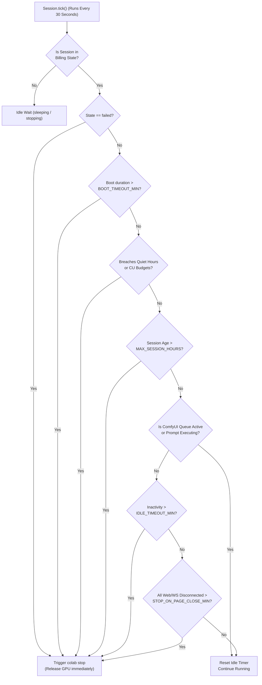

# Auto-Stop, Wake Admission, and CU Budget Management

Google Colab compute units (CU) represent finite cloud spend. Comfy Colab Kit implements a **three-tier defensive barrier** to ensure that compute resources are provisioned strictly when needed and cleanly terminated the moment work finishes.

---

## 1. Decision Flowchart (`Session.tick`)

All rules reside in `apps/gate/stopper.py` as pure functions and are evaluated every 30 seconds:



---

## 2. Wake Admission Rules (`admit_wake`)

Before `colab new` is called, the gate evaluates admission policies. If a rule triggers, the request is rejected with `409 Conflict`:

| Reason | Condition | Environment Variable |
|---|---|---|
| `quiet_hours` | Current local time is inside the prohibited window (supports midnight wrap, e.g. `23:30-07:00`) | `QUIET_HOURS`, `TZ` |
| `daily_budget` | Compute units accrued today ≥ daily threshold | `DAILY_CU_BUDGET` (0 = disabled) |
| `monthly_budget` | Compute units accrued this month ≥ monthly threshold | `MONTHLY_CU_BUDGET` (0 = disabled) |
| `low_balance` | Balance reported by `colab ccu-info` < safety threshold | `MIN_CU_BALANCE` |

---

## 3. Auto-Stop Rules (`evaluate`, in Priority Order)

| Reason | Trigger Condition | Knob / Variable |
|---|---|---|
| `failed` | Booting encountered fatal error (VM exists, immediate shutdown) | Handled automatically |
| `boot_timeout` | VM has been in a boot state longer than allowed limit | `BOOT_TIMEOUT_MIN` (default: 40m) |
| `quiet_hours` / `daily_budget` / `monthly_budget` / `low_balance` | Policy threshold breached while session was active | Evaluated every 30s |
| `max_session` | Session duration ≥ `MAX_SESSION_HOURS` + extensions × `EXTEND_HOURS` | `MAX_SESSION_HOURS` (default: 6h) |
| `idle` | ComfyUI queue is empty AND no HTTP/WS traffic for N minutes | `IDLE_TIMEOUT_MIN` (default: 30m) |
| `page_closed` | ComfyUI queue is empty AND all browser tabs / overlays closed for N minutes | `STOP_ON_PAGE_CLOSE_MIN` (default: 5m) |

---

## 🛡️ Fail-Safe 1: Queue-Aware Inactivity Guard

The gate evaluates inactivity using two complementary rules:
1. **`idle` (`IDLE_TIMEOUT_MIN`)**: Measures elapsed time since the last HTTP request or WebSocket packet was processed.
2. **`page_closed` (`STOP_ON_PAGE_CLOSE_MIN`)**: Measures elapsed time since the last active browser tab or client overlay disconnected.

> [!IMPORTANT]
> **Active Generation Protection**:
> Neither `idle` nor `page_closed` will **ever** stop the VM while ComfyUI is generating images or has tasks queued. The gateway probes ComfyUI's internal endpoints (`/queue` and `/system_stats`) every 30 seconds. As long as `queue_running` or `queue_pending` exceeds 0, idle counters remain frozen at zero.

---

## 🛡️ Fail-Safe 2: The Colab-Side Heartbeat Watchdog

What happens if the VPS crashes, Docker daemon halts, or network connectivity between the VPS and Colab drops? Without a mechanism running directly on the VM, the remote Colab instance would continue running and draining Compute Units until your Google quota hit zero.

Comfy Colab Kit solves this with a Colab-side watchdog that runs as its **own process** on the VM
(`packages/colab/setup.py`, started with `KIT_WATCHDOG_ONLY=1`). It is deliberately *not* a thread
inside the setup cell: setup.py returns once ComfyUI is ready so the Jupyter kernel stays free for
later `colab exec` calls (the gate heartbeat and the on-demand model fetch both need the kernel),
and a separate process keeps the cost guard alive after that.
1. The gate touches the Colab kernel every ~90 seconds (the same exec that refreshes
   `/content/kit_heartbeat`), which is also what keeps an idle runtime from being reclaimed.
2. If the Colab kernel does not receive a heartbeat probe from the gate within **`WATCHDOG_GATE_LOST_MIN`** (default: 20 minutes), the watchdog concludes that the managing gateway is unreachable.
3. The watchdog executes Google Colab's native kernel self-termination command:
   ```python
   from google.colab import runtime
   runtime.unassign()
   ```
   The VM is released immediately on Google's infrastructure, capping worst-case unattended spend.

---

## 📊 Local Compute Unit (CU) Ledger

Compute units accrue continuously whenever the session is in a billing state (`allocating`, `installing`, `downloading`, `booting`, `smoke_testing`, `ready`, `switching`, `failed`).
- The gate updates an on-disk ledger (`data/state/cu_ledger.json`) tracking `today` and `month` usage based on `CU_PER_HOUR` (default: 1.71 for Colab L4).
- The background loop queries `colab ccu-info` periodically to refresh the ground-truth Google balance.
- Live CU metrics are surfaced to viewers on the Wake card and exposed via `GET /_gate/status`.
