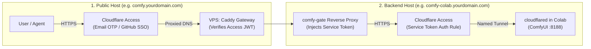

# Cloudflare Zero Trust & Access Architecture

Comfy Colab Kit utilizes a **Dual-Hostname Zero Trust Architecture** that isolates public user authentication from the private backend compute VM.

---

## 1. Dual-Hostname Request Flow



---

## 2. Hostname Responsibilities

### Public Host (`PUBLIC_HOST`)
- **DNS**: Proxied `A` or `AAAA` record pointing to your VPS public IPv4/IPv6. SSL/TLS encryption mode set to **Full (strict)**.
- **Access Application**: Self-hosted application covering `PUBLIC_HOST`. Configured with an **Allow** policy restricting access to authorized team emails or identity providers.
- **Audience Tag**: The Application AUD tag is saved in `.env` as `CF_ACCESS_AUD`. The gate cryptographically validates the `Cf-Access-Jwt-Assertion` header on every incoming request against Cloudflare's public JWKS keys.

### Backend Host (`COLAB_TUNNEL_HOST`)
- **DNS**: Proxied `CNAME` pointing to the remotely-managed Cloudflare Named Tunnel.
- **Access Application**: Self-hosted application covering `COLAB_TUNNEL_HOST`. Configured with a single **Service Auth** rule that permits access *only* when valid `CF-Access-Client-Id` and `CF-Access-Client-Secret` headers are present.
- **Isolation**: Nobody can access `COLAB_TUNNEL_HOST` directly through a web browser. Only `comfy-gate` holds the Service Token (`secrets/cf_service.json`), ensuring all traffic must pass through the gateway's state machine, rate limits, and authentication guards.

---

## 3. Automated Configuration with `scripts/cf-setup.sh`

The included setup script is fully idempotent. To run it, create a Cloudflare API Token with the following permissions:
- **Account** > **Cloudflare Tunnel**: `Edit`
- **Account** > **Access: Apps and Policies**: `Edit`
- **Account** > **Access: Service Tokens**: `Edit`
- **Zone** > **DNS**: `Edit`

Execute the script on your VPS:
```bash
ZONE_NAME="yourdomain.com" \
COLAB_TUNNEL_HOST="comfy-colab.yourdomain.com" \
CLOUDFLARE_API_TOKEN="your-api-token" \
scripts/cf-setup.sh
```

The script will automatically configure the tunnel, create the DNS CNAME, generate the service token, and write `secrets/colab_tunnel_token`, `secrets/cf_service.json`, and `secrets/cf_ids.json` with secure `0600` permissions.

---

## 4. How to Bypass Cloudflare Access (Dual-Host Bypass)

If you want to completely disable login prompts (for friends, internal testing, or open access), you **MUST** configure Bypass on **BOTH** Access Applications:

### Why Both Applications Must Be Bypassed:
1. **Frontend App (`PUBLIC_HOST`, e.g. `comfy-colab-kit`)**: Protects the gateway wake card. If not bypassed, users see the email OTP login prompt when first opening the site.
2. **Backend App (`COLAB_TUNNEL_HOST`, e.g. `comfy-colab-kit-backend`)**: Protects the Colab VM tunnel. Once ComfyUI boots (`state: ready`), the gateway embeds ComfyUI via an `<iframe>` pointing to `COLAB_TUNNEL_HOST`. If this backend app is not bypassed, the browser will be blocked from loading ComfyUI inside the iframe!

### Step-by-Step Configuration:
1. **Cloudflare Zero Trust Dashboard**:
   - Go to **Access** > **Applications**.
   - Open **App 1 (`comfy-colab-kit`)** > **Policies** > Add Policy:
     - Name: `Bypass-All`
     - Action: `Bypass`
     - Include: `Everyone` (Order: 1st)
   - Open **App 2 (`comfy-colab-kit-backend`)** > **Policies** > Add Policy:
     - Name: `Bypass-All`
     - Action: `Bypass`
     - Include: `Everyone` (Order: 1st)
2. **VPS Gateway Configuration**:
   - In `.env` on your VPS, enable `AUTH_DISABLED=true`:
     ```bash
     sed -i 's/^# *AUTH_DISABLED=.*/AUTH_DISABLED=true/' .env
     docker compose -f deploy/docker-compose.yml up -d
     ```
   - This instructs `comfy-gate` to accept requests without Cloudflare JWT assertions and grants all visitors owner privileges.

---

## 5. Unified Multi-Domain Application (Best Practice)

Rather than maintaining two disconnected Access applications that require cross-origin cookie syncing, comfy-colab-kit uses a single **Multi-Domain Access Application** with **Eager Redirect Cookie** enabled:

| Component | Target Host(s) | Required Cloudflare Access Policies | Role in Protected Mode |
|---|---|---|---|
| **Unified Access App** (`comfy-colab-kit`) | • `comfy.yourdomain.com`<br>• `comfy-colab.yourdomain.com` | • Policy 1 (`Service Auth`): `gate service token only`<br>• Policy 2 (`Allow`): `Everyone` (or `ALLOWED_EMAILS`) | Challenges visiting browsers with Email OTP / SSO. Preemptively drops authentication cookies onto both domains via Eager Redirect so the ComfyUI iframe loads seamlessly without CSP frame-ancestors errors. |
| **VPS Gateway** | `comfy-gate:8080` | `.env`: `AUTH_DISABLED=false`<br>(or remove/comment out `AUTH_DISABLED`) | Cryptographically verifies incoming `Cf-Access-Jwt-Assertion` against Cloudflare JWKS. |

> [!TIP]
> **Why Multi-Domain App with Eager Redirect?**
> When users authenticate to `comfy.yourdomain.com`, Cloudflare Access automatically chains an eager background redirect to `comfy-colab.yourdomain.com` and drops the `CF_Authorization` cookie on both hostnames. When the session reaches `state: ready`, the browser's `<iframe>` already possesses the backend credentials, avoiding third-party login prompts and CSP `frame-ancestors 'none'` blocks.
>
> **Identity Providers (Google, GitHub, OTP)**:
> In Cloudflare Zero Trust (**Settings** > **Authentication**), you can connect Google OAuth and GitHub OAuth alongside the default One-Time PIN (OTP). When configuring Access Policies:
> - Setting Policy Include to `Everyone` allows any user with a valid Google, GitHub, or Email account to log in.
> - OTP emails to QQ Mail, 163, and others will only be sent if the address matches an Access policy (anti-enumeration protection).
> - On the gateway side, Mode B (`OWNER_ONLY_CONTROL=true`, default) ensures that only addresses listed in `OWNER_EMAILS` can wake or stop the GPU, while all authenticated team members can share access once ready.
