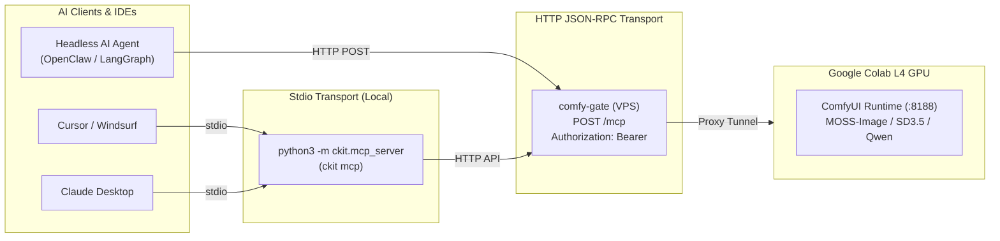

# Model Context Protocol (MCP) Guide

Comfy Colab Kit provides first-class support for the **Model Context Protocol (MCP)**, enabling autonomous AI coding agents, IDE assistants, and workflow runners (Cursor, Claude Desktop, Windsurf, OpenClaw, Antigravity, LangGraph) to wake, monitor, generate images with, and shut down Google Colab GPU instances without manual browser baby-sitting.

---

## 🧭 Overview & Architecture

Comfy Colab Kit provides two deployment modes for MCP:



1. **Stdio MCP Server (`ckit mcp`)**: Runs locally on your workstation as a subprocess spawned by your IDE or Claude Desktop. Authenticates to your gate using local credentials (`~/.agents/.env` or `~/.config/ckit/config.json`).
2. **Remote HTTP / Streamable MCP (`POST /mcp` / `POST /_gate/mcp`)**: Runs directly on your VPS gateway as an HTTP JSON-RPC 2.0 endpoint. Ideal for headless remote agents or cloud runners that communicate over HTTPS with `Authorization: Bearer <agent_token>`.

---

## 🛠️ Available MCP Tools

The MCP server exposes 5 specialized, high-leverage tools:

| Tool Name | Purpose | Key Arguments | Return Value |
|---|---|---|---|
| `gate_status` | Inspect session state, active profile, queue busy flag, and real-time CU balance. | *None* | JSON object with `state`, `profile`, `cu` metrics, and user permissions. |
| `gate_wake` | Wake or join the shared Colab L4 GPU instance with a model profile. Idempotent. | `profile`: e.g. `"moss-image"` (optional) | Confirmation message with current state (`ready`, `allocating`, etc.). |
| `gate_txt2img` | **High-level text-to-image generator**! Executes the MOSS-Image DeBand pipeline with anti-banding LoRAs and fast sampling. | `prompt`: positive text (required)<br/>`negative_prompt`: negative text<br/>`preset`: `"Fast alt"` (default, 10 steps), `"Fast"`, `"Balanced"`, `"Quality"`<br/>`seed`: integer<br/>`width` / `height`: dimensions (default 1024) | Structured JSON with `prompt_id` and markdown-embedded image URLs (`/view?filename=...`). |
| `gate_generate` | Submit a raw ComfyUI prompt graph dictionary and wait for image completion. | `prompt`: ComfyUI node graph JSON (required)<br/>`timeout_seconds`: int (default 180) | Output image metadata, filename, and direct URLs. |
| `gate_stop` | Terminate the Colab VM immediately to stop Compute Unit consumption. | *None* | Final state confirmation (`"stopping"`). |

---

## ⚙️ Client Configuration

### 1. Cursor (`~/.cursor/mcp.json`)
Add the `comfy-colab` server to your Cursor MCP settings:

```json
{
  "mcpServers": {
    "comfy-colab": {
      "command": "python3",
      "args": ["-m", "ckit.mcp_server"],
      "env": {
        "CKIT_URL": "https://comfy.yourdomain.com",
        "CKIT_TOKEN": "YOUR_AGENT_BEARER_TOKEN"
      }
    }
  }
}
```

### 2. Claude Desktop (`claude_desktop_config.json`)
- **macOS**: `~/Library/Application Support/Claude/claude_desktop_config.json`
- **Windows**: `%APPDATA%\Claude\claude_desktop_config.json`

```json
{
  "mcpServers": {
    "comfy-colab": {
      "command": "python3",
      "args": ["-m", "ckit.mcp_server"],
      "env": {
        "CKIT_URL": "https://comfy.yourdomain.com",
        "CKIT_TOKEN": "YOUR_AGENT_BEARER_TOKEN"
      }
    }
  }
}
```

### 3. Universal Agent Configuration (`~/.agents/.env` or `~/.agents/mcp.json`)
To share credentials across all agents in your environment:
```bash
# In ~/.agents/.env
CKIT_URL="https://comfy.yourdomain.com"
CKIT_TOKEN="YOUR_AGENT_BEARER_TOKEN"
```

### 4. Remote HTTP MCP (for Streamable MCP Clients)
If your agent framework supports remote HTTP/SSE MCP endpoints:
- **URL**: `https://comfy.yourdomain.com/mcp`
- **Method**: `POST` (JSON-RPC 2.0)
- **Header**: `Authorization: Bearer <YOUR_AGENT_BEARER_TOKEN>`

---

## 🚀 Obtaining Credentials & Pairing

You can acquire credentials in two convenient ways:

### Method A: 1-Click Copy in Browser
1. Log into your Comfy Colab Kit wake page (`https://comfy.yourdomain.com`).
2. Click the user profile icon in the top-right corner.
3. Click **🤖 复制 AI Agent 接入指令 / Copy Prompt for AI Agent**.
4. A pre-authorized Bearer token is generated (or reused), and a comprehensive prompt containing your exact MCP configuration is copied to your clipboard.

### Method B: Terminal Device Flow Pairing (RFC 8628)
If working directly from a shell:
```bash
python3 -m ckit auth https://comfy.yourdomain.com
```
The CLI prints a verification URL and opens your browser. Click **Approve**, and the token is automatically saved to `~/.config/ckit/config.json`.

---

## 🎨 Workflow Querying & Image-to-Image (Img2Img)

### 1. Querying Available Workflows
Before generating images, agents can discover available model profiles and registered workflows:
```bash
# Human-readable table
ckit profiles

# Machine-readable JSON
ckit profiles --json
```
Or via HTTP: `GET /_gate/profiles` (relative to Base URL).

### 2. Image-to-Image (Img2Img) Reference Upload
For tasks requiring a reference image (e.g. style transfer, character preservation, inpainting):
1. **Upload Reference Image**: Send a `multipart/form-data` POST request to `/upload/image`:
   ```bash
   curl -X POST "https://comfy.yourdomain.com/upload/image" \
     -H "Authorization: Bearer <TOKEN>" \
     -F "image=@reference.png" \
     -F "overwrite=true"
   ```
   **Response**: `{"name": "reference.png", "subfolder": "", "type": "input"}`.
2. **Submit Graph**: Call `gate_generate` or `POST /prompt` using the `matlowai-img2img` workflow, referencing the uploaded image filename in the `LoadImage` node.
3. **Tune Denoise**:
   - `0.2 ~ 0.35`: HD enhancement / detail cleanup (strict composition lock).
   - `0.4 ~ 0.65`: Style, clothing, or lighting variation.
   - `0.7 ~ 1.0`: Heavy creative re-imagination.

---

## 💡 Best Practices for AI Agents

1. **Check Status First**: Always call `gate_status` before initiating generation. If the machine is asleep, invoke `gate_wake` and wait until `state == "ready"`.
2. **Prefer High-Level Tools**: For standard image creation, prefer `gate_txt2img`. It automatically applies optimal presets (`Fast alt`), dimensions, and anti-banding LoRAs.
3. **Be Cost-Conscious (Owner Stop Rule)**: Colab L4 GPU consumes Compute Units (~1.71 CU/hour). When a multi-image task is finished and the user confirms they are done, the agent should call `gate_stop` to spin down the VM.
4. **Report CU Balance**: Include the remaining balance in your completion summary (e.g. *"Image generated successfully. Remaining GPU budget: 22.86 CU."*). Warn the user if `balance < 2.0`.
