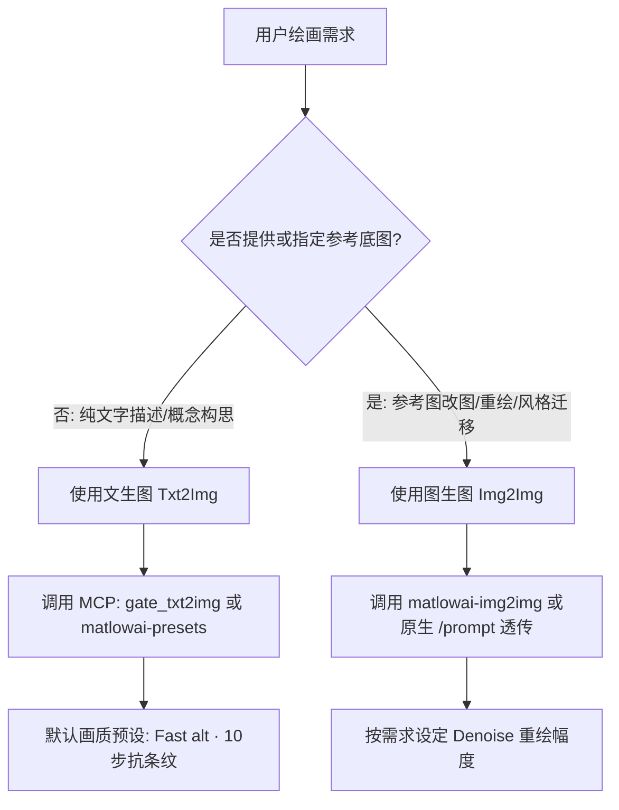

# Comfy Colab Kit Operator Skill (`/comfy-colab-kit`)

本 Skill 专为接入并操作 **Comfy Colab Kit** 绘图网关的自主 AI Agent 设计。包含任务决策、生命周期管理、CU 算力核对、原生 ComfyUI API 透传与关机释放策略。

---

## 1. 核心凭据与端点解析

Agent 操作网关时，网关地址与凭据按以下优先级解析：
1. **环境变量**: `CKIT_URL` (如 `https://comfy.firetable.tech`), `CKIT_TOKEN`
2. **通用 Agent 配置**: `~/.agents/.env` 中的 `CKIT_URL` 与 `CKIT_TOKEN`
3. **全局 CLI 配置**: `~/.config/ckit/config.json`

所有 HTTP 接口均使用**相对路径**描述，由 Agent 拼接 Base URL，请求头附带：
`Authorization: Bearer <CKIT_TOKEN>`

---

## 2. 选型决策：什么时候用文生图？什么时候用图生图？



### A. 文生图 (Text-to-Image)
- **触发时机**：用户输入场景、人物、产品、艺术画面描述，未提供参考底图。
- **推荐工具**：
  - **MCP 工具**：`gate_txt2img(prompt=..., negative_prompt=..., preset="Fast alt", seed=..., width=1024, height=1024)`
  - **默认预设**：`"Fast alt"`（10 步急速生成，画质优异且彻底去除条纹色带）。
  - **负向提示词**：默认配置 `worst quality, bad anatomy, watermark, jpeg artifact`。

### B. 图生图 (Image-to-Image)
- **触发时机**：用户给出了参考图片，要求在原图基础上进行微调、画面扩展、姿态保持重绘或风格转换。
- **推荐工作流**：`matlowai-img2img`。
- **关键参数 `denoise` (重绘幅度)**：
  - `0.2 ~ 0.35`：微调质感、去噪增强、高清放大，构图完全保持。
  - `0.4 ~ 0.65`：适度改变细节、服装、发型或光影，主体轮廓保留。
  - `0.7 ~ 1.0`：剧烈重新创作，仅保留原图大概色彩与氛围。

---

## 3. 权限判断与 Owner 处理机器规范

### 权限获取与确认
每次操作前调用 `gate_status`（相对路径 `GET /_gate/status`），检查响应中的 `you` 字段：
```json
{
  "state": "ready",
  "you": {
    "email": "user@example.com",
    "owner": true,
    "can_wake": true,
    "can_stop": true
  }
}
```

### Owner 处理机器策略
- **具备全部权限**：`owner === true` 的用户具备机器唤醒、关机（Stop）、切换模型（Switch）和延期（Extend）权限。
- **成本与算力意识**：Colab L4 GPU 按计算单元 (CU) 计费（约 1.71 CU/小时）。
- **生成完成后的处理**：
  - 当一轮生图全部完成，且用户明确表示“好了/完成了/暂时不需要生图”时，Agent 应**主动询问或执行关机**（调用 `gate_stop` 或相对路径 `POST /_gate/stop`），释放 GPU 算力。
  - 避免让 GPU 机器长时间处于空转状态。
- **如果是 Member (普通协作者)**：
  - 无权执行主动关机；在机器 `ready` 时直接生图即可，网关闲置超时会自动休眠。

---

## 4. 算力指标与 CU 消耗确认

在调用 `gate_status` 时，响应包含 `cu` 节点：
```json
"cu": {
  "today": 1.27,      // 今日消耗 CU
  "month": 11.0,      // 本月累计 CU
  "balance": 22.86,   // 剩余可用 CU
  "per_hour": 1.71    // 每小时扣除速率
}
```
- **生图汇报**：生成结束后，Agent 可在回复中附带当前 CU 余额，例如：“本次绘画已完成，当前 GPU 算力余额为 22.86 CU。”
- **低余额告警**：若 `balance < 2.0`，主动提醒用户 Colab 计算单元即将耗尽。

---

## 5. 完整生图操作流程 (Lifecycle)

1. **检查状态**：调用 MCP `gate_status`（或 `GET /_gate/status`）。
2. **唤醒 (如需)**：
   - 若 `state === "sleeping"`：
     - 若为 Owner，调用 `gate_wake(profile="moss-image")`（或 `POST /_gate/wake`）。
     - 等待状态轮询变为 `"ready"`（通常需要 80~100 秒分配显卡并加载模型）。
   - 若处于 `allocating` / `downloading` / `booting`：等待就绪即可。
3. **执行生成**：
   - 首选 MCP `gate_txt2img`，生成完成后直接返回结果图片 URL。
4. **交付结果**：
   - 向用户呈现生成的图片 Markdown 预览与链接。
5. **结束关机**：
   - 确认无后续绘画任务时，调用 `gate_stop` 释放机器。

---

## 6. 原生 ComfyUI 接口透传机制 (Passthrough)

当 Gateway 状态为 `ready` 时，网关同时扮演安全反向代理角色，所有原生 ComfyUI 请求直接透传到后端内核：

| 原生 ComfyUI 相对路径 | 请求方法 | 作用 |
|---|---|---|
| `/prompt` | `POST` | 提交原生 node graph JSON 进行生图排队 |
| `/history/{prompt_id}` | `GET` | 查询指定任务执行进度及输出图像文件名 |
| `/view` | `GET` | 获取生成好的图像：`/view?filename={filename}&type=output` |
| `/ws?clientId={id}` | `GET` | 实时 WebSocket 执行进度与预览流 |
| `/object_info` | `GET` | 获取当前 ComfyUI 所有可用节点类与参数 schema |

Agent 发起原生透传请求时，仅需将相对路径拼接在网关 Host 上，并携带 `Authorization: Bearer <CKIT_TOKEN>` 即可。
