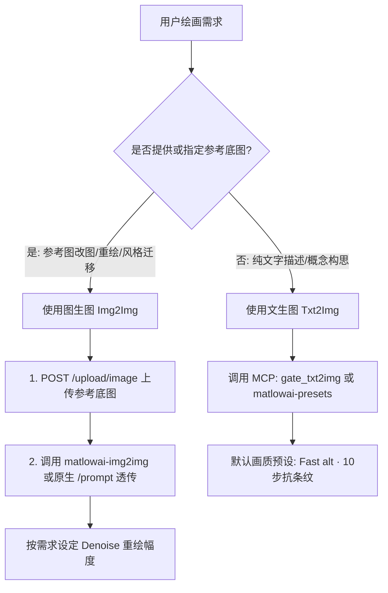

# Comfy Colab Kit Operator Skill (`/comfy-colab-kit`)

本 Skill 专为接入并操作 **Comfy Colab Kit** 绘图网关的自主 AI Agent 设计。包含工具安装、工作流查询、任务决策、参考图上传、生命周期管理、CU 算力核对、原生 ComfyUI API 透传与关机释放策略。

---

## 1. 核心凭据与端点解析

Agent 操作网关时，网关地址与凭据按以下优先级解析：
1. **环境变量**: `CKIT_URL` (如 `https://comfy.example.com`), `CKIT_TOKEN`
2. **通用 Agent 配置**: `~/.agents/.env` 中的 `CKIT_URL` 与 `CKIT_TOKEN`
3. **全局 CLI 配置**: `~/.config/ckit/config.json`

所有 HTTP 接口均使用**相对路径**描述，由 Agent 拼接 Base URL，请求头附带：
`Authorization: Bearer <CKIT_TOKEN>`

---

## 2. 获取与安装 ckit CLI 工具

`ckit` 是专为 Agent 和工程师打造的轻量命令行工具与 MCP 服务器，**完全基于 Python 3 标准库，无任何第三方 pip 运行时依赖**。

### 安装方式 (任选其一)
- **通过 pip 安装 (推荐)**:
  ```bash
  pip install "git+https://github.com/FireTable/comfy-colab-kit.git"
  ```
- **通过 uv 工具安装**:
  ```bash
  uv tool install "git+https://github.com/FireTable/comfy-colab-kit.git"
  ```
- **单脚本免安装运行 (直接下载)**:
  ```bash
  mkdir -p ~/.local/bin
  curl -sSL "https://raw.githubusercontent.com/FireTable/comfy-colab-kit/main/packages/cli/ckit" -o ~/.local/bin/ckit
  chmod +x ~/.local/bin/ckit
  ```
- **从本地仓库源码运行**:
  ```bash
  pip install -e .
  # 或直接执行 python3 packages/cli/ckit
  ```

### 常用命令速查
- `ckit status [--json]`: 检查 GPU 实例状态、当前模型 Profile、排队情况与 CU 余额
- `ckit profiles [--json]`: 查询网关支持的所有模型 Profiles 及 Workflows 工作流列表
- `ckit wake [--profile ID] [--wait]`: 唤醒或加入 GPU 实例（加入现有会话无需重复开机）
- `ckit generate --prompt "..." [--negative "..."] [--preset "Fast alt"]`: 执行快速文生图
- `ckit stop`: 立即关闭 GPU 实例，停止扣费
- `ckit mcp`: 启动标准输入输出 (stdio) MCP 服务

---

## 3. 怎么查询支持的 ComfyUI 工作流 (Profiles & Workflows)

在生图前，Agent 可以通过以下三种方式动态获取网关支持的模型 Profile 及旗下全部可用工作流：

### 方式 A: 通过 CLI 命令行查询
```bash
# 人类易读格式
ckit profiles

# Agent 结构化 JSON 格式
ckit profiles --json
```

### 方式 B: 通过网关 HTTP API (相对路径)
请求相对路径：`GET /_gate/profiles`
携带请求头：`Authorization: Bearer <CKIT_TOKEN>`

**响应 JSON 示例**:
```json
{
  "default": "moss-image",
  "profiles": [
    {
      "id": "moss-image",
      "title": "MOSS-Image (DeBand int8 default · 4-step fast · official quality/layout · edit)",
      "accelerator": "L4",
      "app_default": "matlowai-presets",
      "workflows": [
        {
          "id": "matlowai-presets",
          "title": "Default · DeBand banding-fix LoRAs on SFT bf16 (+ DMD/DMAD fast modes)",
          "optional": false,
          "license": "Apache-2.0"
        },
        {
          "id": "matlowai-img2img",
          "title": "Img2Img · DeBand LoRAs on SFT bf16 with Denoise",
          "optional": false,
          "license": "Apache-2.0"
        },
        {
          "id": "akhaliq-4step",
          "title": "Fast · 4-step turbo LoRA (akhaliq)",
          "optional": false
        },
        {
          "id": "official-t2i",
          "title": "Quality · official Text to Image (Comfy-Org)",
          "optional": false
        }
      ]
    },
    {
      "id": "sd-latest",
      "title": "Stable Diffusion 3.5 (Large fp8 default · TurboX / Medium turbo)",
      "workflows": [...]
    },
    {
      "id": "qwen-image",
      "title": "Qwen-Image 2.1 (Turbo default · T2I / Edit)",
      "workflows": [...]
    }
  ]
}
```

### 方式 C: 查询当前活跃会话状态
请求相对路径：`GET /_gate/status`
响应中 `profile` 字段即为当前 GPU 运行的模型配置，`default_view` 指示默认视图（`app` 或 `graph`）。

---

## 4. 选型决策：什么时候用文生图？什么时候用图生图？



### A. 文生图 (Text-to-Image)
- **触发时机**：用户输入场景、人物、产品、艺术画面描述，未提供参考底图。
- **推荐工具**：
  - **MCP 工具**：`gate_txt2img(prompt=..., negative_prompt=..., preset="Fast alt", seed=..., width=1024, height=1024)`
  - **默认预设**：`"Fast alt"`（10 步急速生成，画质优异且彻底去除条纹色带）。
  - **负向提示词**：默认配置 `worst quality, bad anatomy, watermark, jpeg artifact`。

### B. 图生图 (Image-to-Image)
- **触发时机**：用户给出了参考图片，要求在原图基础上进行微调、画面扩展、姿态保持重绘或风格转换。
- **推荐工作流**：`matlowai-img2img`。
- **必须步骤**：先调用 `POST /upload/image` 上传图片获取服务器端文件名。
- **关键参数 `denoise` (重绘幅度)**：
  - `0.2 ~ 0.35`：微调质感、去噪增强、高清放大，构图完全保持。
  - `0.4 ~ 0.65`：适度改变细节、服装、发型或光影，主体轮廓保留。
  - `0.7 ~ 1.0`：剧烈重新创作，仅保留原图大概色彩与氛围。

---

## 5. 原生 ComfyUI 接口透传与开放接口清单

当 Gateway 状态为 `ready` 时，网关同时扮演安全反向代理角色，所有原生 ComfyUI 请求直接透传到后端内核。**所有接口均受 Bearer Token 保护并绕过 Cloudflare 访问拦截**。

### 核心开放接口清单 (全部使用相对路径)

| 相对路径 | 请求方法 | 数据格式 | 作用与功能说明 |
|---|---|---|---|
| `/upload/image` | `POST` | `multipart/form-data` | **图生图核心**：上传参考底图到 ComfyUI input 目录 |
| `/upload/mask` | `POST` | `multipart/form-data` | **局部重绘**：上传 Inpainting 蒙版图 |
| `/prompt` | `POST` | `application/json` | 提交原生 node graph JSON 任务排队 |
| `/prompt` | `GET` | `application/json` | 查询当前队列中的任务列表与剩余任务数 |
| `/history/{prompt_id}` | `GET` | `application/json` | 查询任务执行结果（包含 outputs 图片文件名） |
| `/view` | `GET` | Query 参数 | 获取生成图或输入图：`/view?filename=...&type=output` |
| `/view_metadata` | `GET` | Query 参数 | 读取已生成图片中内嵌的 prompt 工作流元数据 |
| `/object_info` | `GET` | `application/json` | 查询所有已安装节点类型、输入输出定义与 schema |
| `/object_info/{node}` | `GET` | `application/json` | 查询特定节点（如 `LoadImage`, `KSampler`）的配置参数 |
| `/system_stats` | `GET` | `application/json` | 查询 GPU 显存 (VRAM)、系统内存与设备状态 |
| `/queue` | `GET` | `application/json` | 查询执行中 (`queue_running`) 与等待中 (`queue_pending`) 任务 |
| `/queue` | `POST` | `application/json` | 清空或删除队列中的任务 (`{"clear": true}`) |
| `/interrupt` | `POST` | `application/json` | 立即中断当前正在执行的绘图计算 |
| `/ws?clientId={id}` | `GET` | WebSocket | 建立实时双向连接，接收节点执行进度与中间预览 |
| `/embeddings` | `GET` | `application/json` | 列出当前可用的 Textual Inversion 嵌入向量 |
| `/extensions` | `GET` | `application/json` | 列出已启用的前端扩展 |

---

## 6. 图生图 (Img2Img) 端到端参考代码示例

### 第一步：上传参考图片 (`POST /upload/image`)

```python
import urllib.request, mimetypes, uuid, json

def upload_reference_image(gateway_url: str, token: str, file_path: str) -> str:
    """上传本地图片到 ComfyUI，返回服务器端分配的文件名。"""
    boundary = f"----WebKitFormBoundary{uuid.uuid4().hex}"
    with open(file_path, "rb") as f:
        file_bytes = f.read()

    body = (
        f"--{boundary}\r\n"
        f'Content-Disposition: form-data; name="image"; filename="{file_path.split("/")[-1]}"\r\n'
        f"Content-Type: image/png\r\n\r\n"
    ).encode() + file_bytes + (
        f"\r\n--{boundary}\r\n"
        f'Content-Disposition: form-data; name="overwrite"\r\n\r\n'
        f"true\r\n"
        f"--{boundary}--\r\n"
    ).encode()

    req = urllib.request.Request(
        f"{gateway_url.rstrip('/')}/upload/image",
        data=body,
        headers={
            "Authorization": f"Bearer {token}",
            "Content-Type": f"multipart/form-data; boundary={boundary}"
        },
        method="POST"
    )
    with urllib.request.urlopen(req) as resp:
        res = json.loads(resp.read())
        # 返回例如: {"name": "ref_image.png", "subfolder": "", "type": "input"}
        return res["name"]
```

### 第二步：将图片名代入工作流并提交 (`POST /prompt`)
在工作流节点的 `LoadImage` 节点中将 `"image"` 设置为返回的 `name`（如 `"ref_image.png"`），调节 `denoise` 后调用 `/prompt` 提交生成。

---

## 7. 权限判断与 Owner 处理机器规范

### 权限获取与确认
每次操作前调用 `gate_status`（相对路径 `GET /_gate/status`），检查响应中的 `you` 字段：
```json
{
  "state": "ready",
  "you": {
    "email": "user@example.com",
    "owner": true,
    "can_wake": true,
    "can_stop": true
  }
}
```

### Owner 处理机器策略
- **具备全部权限**：`owner === true` 的用户具备机器唤醒、关机（Stop）、切换模型（Switch）和延期（Extend）权限。
- **成本与算力意识**：Colab L4 GPU 按计算单元 (CU) 计费（约 1.71 CU/小时）。
- **生成完成后的处理**：
  - 当一轮生图全部完成，且用户明确表示“好了/完成了/暂时不需要生图”时，Agent 应**主动询问或执行关机**（调用 `gate_stop` 或相对路径 `POST /_gate/stop`），释放 GPU 算力。
  - 避免让 GPU 机器长时间处于空转状态。
- **如果是 Member (普通协作者)**：
  - 无权执行主动关机；在机器 `ready` 时直接生图即可，网关闲置超时会自动休眠。

---

## 8. 算力指标与 CU 消耗确认

在调用 `gate_status` 时，响应包含 `cu` 节点：
```json
"cu": {
  "today": 1.27,      // 今日消耗 CU
  "month": 11.0,      // 本月累计 CU
  "balance": 22.86,   // 剩余可用 CU
  "per_hour": 1.71    // 每小时扣除速率
}
```
- **生图汇报**：生成结束后，Agent 可在回复中附带当前 CU 余额，例如：“本次绘画已完成，当前 GPU 算力余额为 22.86 CU。”
- **低余额告警**：若 `balance < 2.0`，主动提醒用户 Colab 计算单元即将耗尽。

---

## 9. 完整生图操作流程 (Lifecycle)

1. **检查状态**：调用 MCP `gate_status`（或 `GET /_gate/status`）。
2. **唤醒 (如需)**：
   - 若 `state === "sleeping"`：
     - 调用 `gate_wake(profile="moss-image")`（或 `POST /_gate/wake`）。
     - 等待状态轮询变为 `"ready"`（当前实测：分配算力 ~10 秒 + 装依赖 ~22 秒 + 下载 24.9 GB 权重 ~30 秒，与 ComfyUI 启动并行；整体约 60~95 秒，取决于 Colab 分配 VM 的快慢）。
   - 若处于 `allocating` / `downloading` / `booting`：等待就绪即可。
3. **执行生成**：
   - 文生图：首选 MCP `gate_txt2img`，生成完成后直接返回结果图片 URL。
   - 图生图：调用 `POST /upload/image` 上传底图，然后调用图生图工作流。
4. **交付结果**：
   - 向用户呈现生成的图片 Markdown 预览与链接。
5. **结束关机**：
   - 确认无后续绘画任务时，Owner Agent 调用 `gate_stop` 释放机器。
